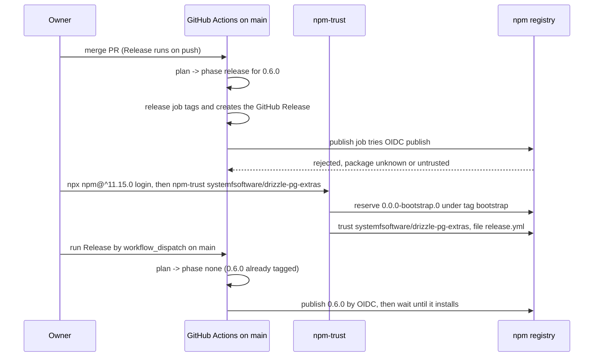

## Goal Capsule

- **Objective:** A systemfsoftware application can install this library from npm, and every version published there was built and published by this repository's release workflow through npm trusted publishing, with no npm token anywhere.
- **Means:** The package becomes `@systemfsoftware/drizzle-pg-extras` in a workspace member, released by the organisation's shared release workflow, called the way the organisation's other libraries call it (KTD1-KTD5).
- **Authority:** The owner's brief, then the shared release workflow's README and `release.yml` at the pinned revision, then the organisation's other public libraries as the shape to copy.
- **Stop conditions:** This repository is public. Visibility, settings, rulesets and environments do not change. No private name, id, path, host or person enters any file, commit or PR text. Nothing is published from this work.
- **Execution profile:** One PR with U1-U6. The plan is committed on its own and nothing is pushed from this run. The owner enrolls trusted publishing after the PR merges (R8).

---

## Product Contract

### Summary

Rename the package to `@systemfsoftware/drizzle-pg-extras`, move it into a workspace member so the release tooling can see it, and add what the shared release workflow asks of a caller: a Nix flake that exposes the package tarballs, release configuration, a change-intent directory, and the `release.yml` caller. The PR body tells the owner to merge first and then run the one-time enrollment command.

### Problem Frame

The unscoped name `drizzle-pg-extras` belongs to the upstream author, whose latest release is 0.6.1, so systemfsoftware cannot publish it. The shared release workflow's enrollment tool trusts only non-private packages in the `@systemfsoftware/` scope, and `@systemfsoftware/drizzle-pg-extras` is unclaimed on the registry (checked 2026-11-20).

The repository today is one package at the root, with no flake, no release configuration and no change-intent directory, and its `ci.yml` cannot be dispatched. The release tooling lists packages with `pnpm ls -r` and drops the workspace root's own row, so a package at the root is invisible to versioning, tagging and release notes (KTD1). Every other organisation library is a private root plus members under `packages/`.

### Requirements

**Name and layout**

- R1. The package is named `@systemfsoftware/drizzle-pg-extras`. Its manifest metadata and the README's install and import lines carry that name.
- R2. `drizzle-pg-extras` stays the CLI bin name and the name used inside the code: the `Symbol.for` keys, generated migration headers, SQL messages and CLI usage text.
- R3. The package is the workspace member `packages/drizzle-pg-extras`. The root is a private manifest that is never published. The published surface stays as v0.6.0 ships it: exports map, bin, `files`, `engines`, peer ranges and licence.

**Release flow**

- R4. `.github/workflows/release.yml` is the organisation's caller: it runs on push to `main` and on `workflow_dispatch`, calls the shared `release.yml` pinned by commit SHA with `ci-workflow: ci.yml` and `npm-publish: true`, grants `id-token: write`, and has a `noop` job off `main`.
- R5. The repository supplies what that workflow reads from a caller: `release.jsonc`, a `.changeset/` directory, a flake whose `packages.<system>.workspace-tarballs` lists the package and whose `devShells.<system>.default` provides pnpm and Node, and a `ci.yml` that accepts `workflow_dispatch`.
- R6. A release PR changes the version by editing the member's `package.json` and `CHANGELOG.md` only. The version a generated migration records follows the manifest. The existing changelog history stays in the member's `CHANGELOG.md`.
- R7. Existing CI still passes from the new layout and still publishes the single `checks / check` aggregate the merge queue gates on.

**Enrollment**

- R8. The PR body states the order, merge first and then enroll, and gives the exact one-time commands from the shared workflow's README. It also says what the owner will see on the first run and how to re-run (U6).

### Key Decisions

- KD1. Publish under the scoped name. (session-settled: user-directed — chosen over publishing the unscoped name: upstream owns it and the enrollment tool skips unscoped packages.) Governs R1.
- KD2. Match the organisation's caller shape and take the same pinned revision the other libraries use. (session-settled: user-directed — chosen over a bespoke publish workflow: the owner asked for the org shape and the reference caller.) Governs R4, R5.
- KD3. Merge the PR first, then enroll. (session-settled: user-directed — chosen over enrolling before merge: the owner fixed this order, and the tool reads the repository's default branch, so enrollment before merge finds no scoped package.) Governs R8.

### Acceptance Examples

- AE1. **Covers R3, R5.** **Given** the merged tree, **when** `.#workspace-tarballs` is built, **then** its `index.json` lists `@systemfsoftware/drizzle-pg-extras` with a tarball whose manifest names that package at the member's version and whose file list is `dist/`, `LICENSE`, `README.md` and `package.json`.
- AE2. **Covers R5, R6.** **Given** the merged tree and no tags, **when** the release tools' `plan` command runs, **then** it reports the package as a member and the phase as `release` for 0.6.0.
- AE3. **Covers R6.** **Given** a scratch copy with one pending intent, **when** the release tools' `bump` command runs and the package is rebuilt, **then** the member's `package.json` and `CHANGELOG.md` hold the new version and generated migrations record it, with no other edit.
- AE4. **Covers R2.** **Given** a project that installs the scoped package, **when** `drizzle-pg-extras generate` runs through the project's scripts, **then** the bin resolves and the migration header reads `Generated by drizzle-pg-extras <version>`.

### Scope Boundaries

- Not changed: repository visibility, settings, branch protection, rulesets, environments and secrets; `src/` behaviour; the exports map, bin, `files`, `engines`, peers and licence.
- Not built, considered: a `changeset-check.yml` workflow. The release workflow does not need it and the organisation's callers differ on it. Adding it would make an intent mandatory on every PR, which is the owner's call.
- Not built, considered: the organisation's `nix.yml` and `nix-cache-push.yml`. Neither is read by the release workflow, and cache push needs an environment and secrets, which are settings.
- Not built, considered: Turbo. The paths gate needs no root Turbo config, and nothing here runs a task graph.

### Deferred to Follow-Up Work

- Cache push to the organisation's Nix cache, so a main push does not rebuild the package store cold (Risks). Needs an environment and secrets set by the owner.
- A `changeset-check.yml` workflow, if the owner wants intents enforced.
- Narrowing `supportedArchitectures` in `pnpm-workspace.yaml` if the cold store build proves too slow. It also drops native packages for contributors on other platforms, so it is a measured choice.

---

## Planning Contract

### Key Technical Decisions

- KTD1. **Move the package into `packages/drizzle-pg-extras`; keep a private root.** The release tools build their member list from `pnpm ls -r --json --depth=-1` and discard the row whose directory is the root (`WorkspaceStoreLive.listMembers`, `dir !== ''`). Plan, version bump, tagging, GitHub Releases and intents all read members, so a root package would get none of them. The alternative, publishing a root package through the tarball builder alone, works for publishing but leaves versioning by hand and no tags or releases; changing the tools is another repository. The move is the largest diff here but it is a mechanical rename that preserves history. Governs R3, R5, R6.
- KTD2. **`changesets` strategy, `storage: repository`, `paths` gate.** The fork-of-a-library precedent (`discern`, `effect-microvm`) keeps per-member `CHANGELOG.md` files. The tools add a `## <version>` section above existing ones and match `## <version>` lines exactly, so this repository's `## 0.6.0` and earlier sections stay and feed the first GitHub Release. The gate is `paths` because the root has no Turbo config; only the unadopted changeset check reads it, but `gate.strategy` is a required key. Governs R5, R6.
- KTD3. **Copy `effect-daemon`'s `release.yml` byte for byte except the pin.** Five libraries (`npm-package`, `hex-schema`, `rx-effect`, `effect-readiness`, `effect-microvm`) pin the shared workflow at `9615867c17489fb04be8bc74f568659d687df612`; the first four callers are byte-identical to the reference apart from that pin. `effect-daemon` pins `1e897828d917341fb7dd444c7bbd6cfa0998caa9` and `discern` pins `776c7b54f16798c13a9cb315fa53d350f9ca4102`. The brief says to use the revision the other libraries use, so the implementer re-reads every sibling's `uses:` line on its default branch and takes the revision most of them share. Governs R4.
- KTD4. **The flake follows the siblings, minus `dprint`.** It keeps the `core` input at a full commit (`15b4d2ab1e2af0a154fad2b9af7bd1f6449b3606`, the reference caller's pin) so `nixpkgs` follows it, leaves `pnpm-release-management` unpinned in `flake.nix` and pinned by `flake.lock`, builds `workspace-tarballs` with `lib.mkPnpmWorkspacePackages` (`pname = "drizzle-pg-extras"`, `pnpm = pkgs.pnpm_12`), and gives the dev shell Node 24 and `pnpm_12`. It drops the `dprint` output because this repository runs `dprint` as a devDependency. The release workflow runs every tool inside this dev shell. Governs R5.
- KTD5. **`packageManager` drops to `pnpm@12.9.0`.** `mkPnpmWorkspacePackages` fails evaluation unless the root's pinned pnpm equals the version Nix provides. Under the `core` pin every sibling uses, `pnpm_12` is 12.9.0 (dev shell evaluated 2026-11-20: `pnpm-12.9.0`, `nodejs-24.22.2`). This replaces the 12.21.0 pin from the tooling swap. The lockfile is regenerated and checked under 12.9.0. Governs R3, R5.
- KTD6. **Derive `VERSION` from the member manifest.** `src/version.ts` holds a literal `0.6.0`, and the Timescale integration test pins that string. The first release PR edits only `package.json`, so the literal would report a stale version in every generated migration and fail the pinned assertion on the release PR's own CI. The build inlines the manifest's version, so the dist never reads `package.json` at runtime. Governs R6.
- KTD7. **Runtime identifiers keep the product name.** `Symbol.for('drizzle-pg-extras.*')` keys, generated headers, `RAISE` messages and CLI text name the tool, not the registry package. Renaming them would change what migrations already written contain and what other copies of the library recognise. Governs R2.
- KTD8. **`ci.yml` gains `workflow_dispatch` and member-aware commands.** The release workflow runs `gh workflow run ci.yml` on the release PR branch, which fails for a workflow without that trigger, and Mergify needs `checks / check` on that head. The squash-message lint is already limited to `pull_request`, so a dispatch skips it. Governs R5, R7.
- KTD9. **Counter-case for publishing at all from this repository's main on every push.** The workflow publishes on every main push that is not a version phase, so an npm outage or a cold build adds a red run per merge. The org accepts this for the benefit that a version npm lacks is always published; this repository follows the shared workflow rather than gating it. Governs R4.

### High-Level Technical Design

What happens from merge to the first package on npm. The first `Release` run is expected to fail at `publish`, because npm does not yet trust the workflow.



### Output Structure

```text
.changeset/README.md
.github/workflows/{ci.yml,release.yml}
commitlint.config.ts
dprint.json
flake.nix
flake.lock
package.json                      private root
pnpm-workspace.yaml
release.jsonc
README.md                         repository landing page
packages/drizzle-pg-extras/
  package.json  README.md  LICENSE  CHANGELOG.md
  src/  tests/
  tsconfig.json  tsdown.config.ts  vitest.config.ts  oxlint.config.ts
```

### Assumptions

- A1. The first scoped version is the current 0.6.0, and this PR carries no change intent. The first run tags it and publishes it. An owner who wants another number adds an intent afterwards; with 0.6.0 untagged, `plan` owes the 0.6.0 release first, so a bump takes a second round.
- A2. `nix` is available to the implementer (it is on the planning host), so U4 and the Nix rows of the Verification Contract run locally.
- A3. The release workflow's README section "Publish to npm" is current. Its "Distribution through Nix" section still says nothing is published to npm, and the workflow itself publishes, so the workflow governs.
- A4. The first `Release` run's `publish` job fails before enrollment. This is inferred from npm accepting trusted publishers only for existing packages (README) and has not been observed.

### Risks and Dependencies

- **Red first run.** After merge the `publish` job fails until the owner enrolls. The PR body says so (R8) and gives the re-run.
- **Cold Nix build per main push.** The `publish` job builds `.#workspace-tarballs`. No cache entry exists for this repository's package store and cache push is deferred, so each push fetches and builds the whole store. The job's 60-minute cap bounds it. Measure the local cold build in U4 and report it.
- **Publish path unproven before merge.** PR CI does not run Nix. The local build, `--rebuild` and the tools' `plan` and `bump` runs in the Verification Contract are the pre-merge proof; the first real run is post-merge.
- **Name confusion.** `npx drizzle-pg-extras` outside a project that installed the scoped package fetches the upstream package. Project scripts that call the bin by name are unaffected.
- **Enrollment account.** The person running the commands needs an npm login allowed to publish in the `@systemfsoftware` scope.
- **Owner approval.** The organisation's merge policy needs the owner's approval for a PR that touches CI or Mergify configuration, as the earlier merge-queue plan records.
- **Lockfile regeneration** under pnpm 12.9.0 can move resolved versions. U1 diffs the lockfile and keeps resolutions unchanged where the ranges allow.

---

## Implementation Units

### U1. Restructure into a private root and one workspace member

- **Goal:** `packages/drizzle-pg-extras` holds the package and the root holds only repository-wide tooling (R3, R7; KTD1, KTD5).
- **Requirements:** R3, R7.
- **Dependencies:** none.
- **Files:** `package.json`; `packages/drizzle-pg-extras/package.json`, `README.md`, `LICENSE`, `CHANGELOG.md`; `packages/drizzle-pg-extras/src/**` and `tests/**` (moved); `packages/drizzle-pg-extras/tsconfig.json`, `tsdown.config.ts`, `vitest.config.ts`, `oxlint.config.ts` (moved); `pnpm-workspace.yaml`; `pnpm-lock.yaml`; `dprint.json`; `.github/workflows/ci.yml`; `README.md` (new root file).
- **Approach:**
  1. Move with `git mv` so history follows. `docs/`, `.github/`, `.mergify.yml`, `commitlint.config.ts` and `dprint.json` stay at the root.
  2. Root manifest: name `drizzle-pg-extras`, `private`, version `0.0.0`, `packageManager` `pnpm@12.9.0`. Its devDependencies are `dprint` and the three commitlint packages. `format` and `format:check` run at the root. `build`, `typecheck`, `lint` and `test` delegate to the member with `pnpm --filter @systemfsoftware/drizzle-pg-extras run <script>`, so CI step names do not change.
  3. The member keeps every other devDependency, `jiti`, the peers and all scripts. `commitlint.config.ts` leaves the member tsconfig's `include`, as the organisation's roots carry no tsconfig for it.
  4. `pnpm-workspace.yaml` gains `packages: ["packages/*"]` and keeps `allowBuilds` and `minimumReleaseAgeExclude`.
  5. `dprint.json` excludes `**/CHANGELOG.md` and `**/dist` in place of the root-only `CHANGELOG.md`.
  6. `ci.yml`: `attw` and `publint` run in the member (`pnpm --filter ... exec`), and the rc lane's `pnpm add -D drizzle-orm@rc drizzle-kit@rc` is filtered to the member. Job names, the aggregate and the lint step stay as they are.
  7. The root `README.md` is composed only of text that already exists in the repository: the package description line from the manifest and a link to the member README. Any new sentence goes through the copy-request process instead.
  8. Regenerate `pnpm-lock.yaml` under 12.9.0 and compare it with the old one (Risks).
- **Execution note:** Mostly layout and config. Prefer install, build and existing-suite smoke checks over new tests.
- **Patterns to follow:** `discern` (`pnpm-workspace.yaml`, root `package.json`, `packages/discern/`).
- **Test expectation:** none -- relocation; the existing suite passing unchanged from the member is the evidence.
- **Verification:** `pnpm install --frozen-lockfile` succeeds; build, typecheck, lint, format check and unit tests pass from the root; the dist file list matches a pre-move build; `git log --follow` on a moved source file reaches pre-move history.

### U2. Rename the package and align metadata

- **Goal:** the package is `@systemfsoftware/drizzle-pg-extras` everywhere a consumer reads a name (R1, R2; KTD7).
- **Requirements:** R1, R2.
- **Dependencies:** U1.
- **Files:** `packages/drizzle-pg-extras/package.json`, `packages/drizzle-pg-extras/README.md`.
- **Approach:**
  1. Set `name`. Add `repository.directory` and point `homepage` at the member's README on GitHub, as `npm-package` does. `bin` stays `drizzle-pg-extras`.
  2. In the README, change only the install line and the three import lines to the scoped name. CLI lines, script examples and prose that name the bin stay.
  3. Leave `src/` untouched (KTD7).
- **Test expectation:** none -- metadata and documentation.
- **Verification:** AE4. A search for `from 'drizzle-pg-extras'` returns nothing; the remaining `drizzle-pg-extras` occurrences are the bin, CLI text and runtime identifiers. In a scratch install of the built tarball, `drizzle-pg-extras --help` runs.

### U3. Derive `VERSION` from the manifest

- **Goal:** the version in generated migrations follows `package.json`, so a release PR edits no source file (R6; KTD6).
- **Requirements:** R6.
- **Dependencies:** U1.
- **Files:** `packages/drizzle-pg-extras/src/version.ts`, `packages/drizzle-pg-extras/tsconfig.json` (only if JSON imports need an option), `packages/drizzle-pg-extras/tests/unit/version.test.ts` (new), `packages/drizzle-pg-extras/tests/integration/timescale.test.ts`.
- **Approach:** export `VERSION` from the manifest's `version` through a JSON import that the build inlines. The unit test reads the manifest from disk on its own, so it does not share the import under test. The Timescale test stops pinning a literal and uses `VERSION`. The seam this catches is a stale constant; it does not prove the published tarball's manifest agrees, which the Verification Contract checks.
- **Test scenarios:**
  - Happy path. `VERSION` equals the `version` field of the member's `package.json`, read from disk in the test.
  - Integration. The up-SQL header from a Timescale `generate` contains `Generated by drizzle-pg-extras ${VERSION}`.
  - Build. `dist/index.js`, `dist/index.cjs` and `dist/cli.js` carry the manifest's version, and a built `generate` run from a working directory outside the package writes it (no runtime path to `package.json`).
  - Rehearsal (scratch copy, not committed). After `bump` moves the manifest, a rebuild records the new version with no source edit (AE3).
- **Verification:** the unit test and the build checks pass; the dist engines target stays Node 18 and the output has no JSON import left.

### U4. Add the Nix flake

- **Goal:** `nix build .#workspace-tarballs` produces the package tarball the publish job reads, and `nix develop` gives the tools a shell (R5; KTD4, KTD5).
- **Requirements:** R5.
- **Dependencies:** U1, U2.
- **Files:** `flake.nix`, `flake.lock`, `.gitignore`.
- **Approach:**
  1. Copy `npm-package`'s `flake.nix` shape (KTD4). Set `description` from the manifest. Keep `nixConfig` with the organisation's substituter and key, as every sibling does.
  2. Generate `flake.lock` with the flake tooling and commit it. Do not hand-write it.
  3. Add `/result`, `/result-*` and `.direnv/` to `.gitignore`.
  4. Track new files with git before evaluating, since a flake sees only tracked files.
  5. Record the cold `nix build` wall time for the PR body (Risks).
- **Execution note:** Prefer the evaluation and build checks in the Verification Contract to unit coverage.
- **Patterns to follow:** `npm-package/flake.nix`, `discern/flake.nix`.
- **Test expectation:** none -- build configuration; proven by evaluating and building the flake.
- **Verification:** AE1, plus a `--rebuild` that reproduces the tarball bit for bit (declaration files must not print inferred unions).

### U5. Add release configuration and the release caller

- **Goal:** a push to `main` runs the shared release workflow against this repository (R4, R5, R6; KTD2, KTD3, KTD8).
- **Requirements:** R4, R5, R6.
- **Dependencies:** U1, U4.
- **Files:** `release.jsonc`, `.changeset/README.md`, `pnpm-workspace.yaml`, `.github/workflows/release.yml`, `.github/workflows/ci.yml`.
- **Approach:**
  1. `release.jsonc`: `base` `main`, `branch` `changeset-release/main`, `versioning.strategy` `changesets`, `gate` `{ "strategy": "paths" }`, with the comment header the siblings carry.
  2. `pnpm-workspace.yaml`: add `versioning.changelog.storage: repository`.
  3. `.changeset/README.md`: take the text of a sibling's file unchanged.
  4. `release.yml`: the reference caller with the pin from KTD3 and nothing else different.
  5. `ci.yml`: add the `workflow_dispatch` trigger. Leave jobs, the aggregate and the lint step as they are.
- **Test expectation:** none -- workflow and configuration; exercised by the release tools and by CI runs (Verification Contract).
- **Verification:** AE2 and AE3 on the merged tree and a scratch copy; the caller differs from the reference only on the `uses:` revision; `pnpm format:check` passes with the new files.

### U6. State the enrollment procedure in the PR body

- **Goal:** the owner can enroll trusted publishing from the PR text alone (R8; KD3).
- **Requirements:** R8.
- **Dependencies:** U1-U5.
- **Files:** none. This is PR text.
- **Approach:** the body carries, in this order:
  1. What changed, in one short paragraph per concern (name, layout, flake, release caller).
  2. **Merge this PR first.** Enrollment reads `main`, and before the merge no scoped package exists there.
  3. The two commands, then, from the shared workflow's README:
     - `npx npm@^11.15.0 login`
     - `nix run github:systemfsoftware/pnpm-release-management#npm-trust -- systemfsoftware/drizzle-pg-extras`
  4. What the tool does: it reserves `@systemfsoftware/drizzle-pg-extras` with `0.0.0-bootstrap.0` under the `bootstrap` tag, then trusts `systemfsoftware/drizzle-pg-extras` and the workflow file `release.yml`.
  5. What the owner sees and does next: the first `Release` run tags 0.6.0 and fails at `publish`; after enrolling, run `Release` on `main` by `workflow_dispatch` (or re-run the failed job), and `0.6.0` is published and verified to install.
  6. The pending off-host checks, each with its command and source (Verification Contract), the schema-validation note for any config that could not be validated, and the cold build time from U4.
  7. The statement that the changeset workflow, the Nix cache push and the first-version number are left to the owner (Deferred, A1).
- **Test expectation:** none -- PR text.
- **Verification:** the body contains no private name, id, path, host or person, and the commands match the README text at the pinned revision.

---

## Verification Contract

| Check | Applies to | Command or evidence |
| --- | --- | --- |
| Install | U1 | `pnpm install --frozen-lockfile` under `pnpm@12.9.0`; lockfile diff reviewed |
| Format, lint, typecheck, build | U1-U5 | `pnpm format:check`, `pnpm lint`, `pnpm typecheck`, `pnpm build` from the root |
| Export surface | U1, U2 | `pnpm --filter @systemfsoftware/drizzle-pg-extras exec attw --pack .` and `exec publint` |
| Unit tests | U1, U3 | `pnpm --filter @systemfsoftware/drizzle-pg-extras exec vitest run tests/unit` |
| Integration tests | U1, U3 | Off-host: CI's Postgres and TimescaleDB jobs, which the unit run does not cover |
| Flake evaluates | U4 | `nix eval .#packages.x86_64-linux.workspace-tarballs.members` lists the scoped package; `nix develop --command pnpm --version` prints 12.9.0 |
| Tarball (AE1) | U4 | `nix build .#workspace-tarballs`; read `index.json`; extract the tarball's `package.json` and file list; run attw and publint on the tarball |
| Reproducible | U4 | `nix build --rebuild .#workspace-tarballs` |
| Release plan (AE2) | U5 | Build `release-tools` at the pinned workflow revision, run its `plan` command inside the dev shell with outputs to a scratch file; expect the member and phase `release`. Read-only |
| Version rehearsal (AE3) | U3, U5 | On a scratch copy outside the repository: add one intent, run `bump`, rebuild, check the manifest, `CHANGELOG.md` and a generated header; delete the copy |
| Caller diff | U5 | The new `release.yml` differs from `effect-daemon`'s only on the `uses:` revision |
| Live behavior | U4-U6 | Pending, off-host: the PR's CI and Mergify checks; then, after the owner enrolls, a `Release` run on `main` that ends with `@systemfsoftware/drizzle-pg-extras@0.6.0` on the registry and installable |

## Definition of Done

- The package is `@systemfsoftware/drizzle-pg-extras` at `packages/drizzle-pg-extras`, with the exports, bin, `files`, `engines`, peers and licence unchanged.
- `release.yml`, `release.jsonc`, `.changeset/`, the flake and `flake.lock` exist, `ci.yml` accepts `workflow_dispatch`, and `checks / check` still aggregates every job.
- The tarball build and its `--rebuild` pass locally, and the tools' `plan` run reports the member and phase `release`.
- `VERSION` follows the manifest, proved by the unit test and the rehearsal.
- The PR body carries the merge-first order, both commands, the first-run expectation, the pending off-host checks and the cold build time.
- No scratch copy, throwaway script or result symlink remains; no private name, id, path, host or person appears in any file, commit or PR text.

---

## Sources and Research

- Shared release workflow, `systemfsoftware/pnpm-release-management`: `README.md` ("Quick start", "Publish to npm"); `.github/workflows/release.yml` (inputs `ci-workflow`, `npm-publish`, `runs-on`, `artifacts-dir`; output `phase`; the `plan` job runs every tool through `nix develop`; the `publish` job builds `.#workspace-tarballs` and publishes each version npm lacks); `nix/npm-trust.sh` (clones the default branch, takes non-private `@<owner>/` manifests, reserves missing names, trusts the caller workflow file); `nix/lib/pnpm-workspace-packages.nix` (reads `packages:` from `pnpm-workspace.yaml`, pins pnpm, writes `index.json`); `packages/workspace-adapter/src/WorkspaceStoreLive.ts` (drops the root row); `docs/ci.md`, `docs/configuration.md`, `docs/change-intents.md`, `docs/legacy-tags.md`; `packages/release-language/src/MemberChangelog.ts` (`## <version>` match).
- Organisation libraries as of 2026-11-20: `effect-daemon` (reference `release.yml`, flake, `release.jsonc`), `npm-package` (flake, member manifest with `repository.directory`), `discern` (fork precedent: `storage: repository`, member `CHANGELOG.md`), `effect-microvm` (`.changeset/README.md`). Caller pins: five libraries at `9615867c…`, `effect-daemon` at `1e897828…`, `discern` at `776c7b54…`.
- Dev shell evaluation of the siblings' flakes under the `core` pins `3ef6c21c…` and `15b4d2ab…`: `pnpm-12.9.0`, Node 24.
- Registry, 2026-11-20: `drizzle-pg-extras` latest 0.6.1, owned by the upstream author; `@systemfsoftware/drizzle-pg-extras` not found (404).
- This repository: `package.json`, `pnpm-workspace.yaml`, `.github/workflows/ci.yml`, `.mergify.yml`, `src/version.ts`, `tests/integration/timescale.test.ts`, `CHANGELOG.md`; `docs/plans/2026-11-20-0349-chore-systemfsoftware-tooling-plan.md` (KD4, KD6, KD7 as the decisions this plan adjusts) and `docs/plans/2026-11-20-1821-chore-mergify-merge-queue-plan.md`.
