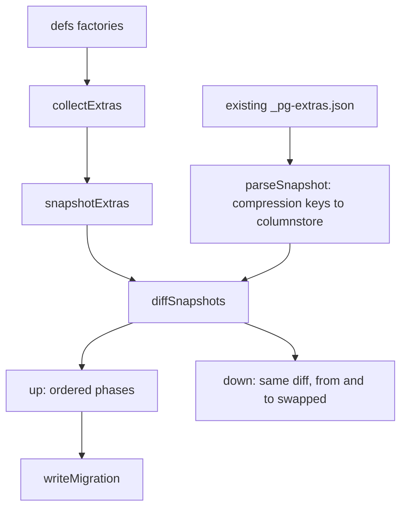

## Goal Capsule

- **Objective:** A downstream application declares every TimescaleDB object it uses, including hypertables with the hypercore columnstore and sparse indexes, continuous aggregates stacked on other aggregates, and every policy it runs, next to its Drizzle schema; `drizzle-pg-extras generate` turns the declarations into reviewed up/down migrations that `drizzle-kit migrate` applies, and `drizzle-pg-extras check` gates drift, using the current TimescaleDB API rather than names kept only for compatibility.
- **Means:** A `continuousAggregate()` extras declaration, a widened `hypertable()` declaration (columnstore, sparse indexes, retention variants, reorder), and the current SQL vocabulary (`by_range`/`by_hash`, `enable_columnstore`, `add_columnstore_policy`, `drop_created_before`) in a stack of four PRs that release together; the stored snapshot accepts the old compression keys once, for upgrades.
- **Authority:** The brief; TimescaleDB 2.32.1 (released 2026-11-19, the latest release) documentation and release notes; the TimescaleDB SQL definitions; drizzle-kit 0.31.11 and drizzle-orm `main` view and migrator behavior; this repository's snapshot, diff, journal, and README contracts; then this plan's KTDs for HOW-level choices.
- **Open blockers:** None.
- **Execution profile:** Four stacked PRs, bottom-up (a fifth only if a unit pushes a PR past the ceiling), one concern each and at most ~400 changed non-test lines per PR. PR1 targets `main`; PR2 targets PR1's branch; PR3 targets PR2's; PR4 targets PR3's. Each PR keeps `checks / check` green on the pinned `timescale/timescaledb:2.32.1-pg16` image and carries its own `.changeset` intent. The stack is linked with `gh stack link` and kept current with `gh stack sync`; merging is bottom-up.
- **Stop conditions:** This repository is public. Visibility, settings, rulesets, and workflows' approval requirements do not change. No private name, id, path, host, person, or credential enters any file or commit. This planning run commits the plan file alone and pushes nothing.
- **Who ships:** `ce-work` implements the units PR by PR in this worktree; the repository's merge queue merges each PR in stack order. Publishing stays with the release workflow and is out of scope here.

---

## Product Contract

Product Contract preservation: unchanged. This enrichment adds the Planning Contract, Implementation Units, Verification Contract, and Definition of Done around the existing R1-R32, F1-F5, AE1-AE10, scope, and assumptions.

### Summary

Declare the current TimescaleDB surface. Hypertables gain the hypercore columnstore with bloom/minmax sparse indexes, columnstore policies with `after` or `created_before`, retention with `drop_after` or `drop_created_before`, and a reorder policy. Continuous aggregates gain hierarchical stacks, real-time aggregation, chunk interval and group-index options, multiple concurrent refresh policies with the current arguments, columnstore settings and policy, and retention. Creation uses the generalized `by_range`/`by_hash` API and the columnstore names; deprecated names are read from old snapshots only.

### Problem Frame

The downstream application hand-writes every TimescaleDB statement it needs. The library covers hypertables, compression settings, retention, and compression policies, but it is behind the current release in three ways: it cannot express a continuous aggregate at all, its hypertable surface stops at the 2.18-era compression vocabulary, and it omits current policy and columnstore options that a hypertable user declares today.

The README excludes continuous aggregates for three reasons, and each one survives scrutiny only with a specific design:

- drizzle-kit owns view DDL, and its materialized-view CREATE has no `timescaledb.*` options. Its typed view config (`PgMaterializedViewWithConfig`) admits storage and autovacuum keys only, so `timescaledb.continuous` cannot pass through. An edited definition is DROP + CREATE, because PostgreSQL has no `CREATE OR REPLACE MATERIALIZED VIEW`. Letting kit own the view therefore produces a plain materialized view, never a continuous aggregate.
- Owning the SELECT appears to make the package responsible for later column changes. It does not have to: the package can store and diff the query text without inferring its output columns, and the typed column contract can stay on a Drizzle view marked `.existing()`.
- The custom migration that the README recommends is the thing this work removes. It has no diff, no down SQL, no idempotent render, and no `check`.

The current release changes the rest of the target. `CREATE TABLE ... WITH (tsdb.hypertable, tsdb.partition_column, tsdb.segmentby, tsdb.orderby, tsdb.sparse_index)` is the documented creation path, but drizzle-kit writes the `CREATE TABLE` and this package does not rewrite that file. The equivalent post-create calls are `create_hypertable(..., by_range(...))`, `ALTER TABLE ... SET (timescaledb.enable_columnstore, ...)`, and the policy functions. `WITH NO DATA` is required inside a transaction, and `ALTER MATERIALIZED VIEW` can flip real-time, change the chunk interval, enable the columnstore, and add a column without a rebuild.

### Current Surface Matrix

Latest release surveyed: **2.32.1, 2026-11-19**. "Declared" means a schema declaration produces SQL through this package; "Not declared" states the reason.

| Surface | Current API in 2.32.1 | Declared | Where, or why not |
| --- | --- | --- | --- |
| Hypertable creation via `CREATE TABLE ... WITH (tsdb.hypertable, ...)` | `tsdb.hypertable`, `tsdb.partition_column`, `tsdb.chunk_interval`, `tsdb.create_default_indexes`, `tsdb.segmentby`, `tsdb.orderby`, `tsdb.sparse_index` | No, equivalent emitted | drizzle-kit writes the table; the package emits the equivalent `create_hypertable`, `ALTER TABLE`, and policy calls (R16, R24) |
| Time and space dimensions | `create_hypertable(relation, by_range(...))`; `add_dimension(relation, by_hash(...))` | Yes | R16 |
| Additional dimensions | `add_dimension(relation, by_range(...) / by_hash(...))` | No | The declaration models the common one time dimension plus one hash dimension; extra dimensions stay hand-written |
| Change the hash partition count | `set_number_partitions` | No | The declaration treats the space dimension as immutable and throws; re-routing is a planned migration, not a silent default |
| Internal chunk schema and prefix | `tsdb.associated_schema`, `tsdb.associated_table_prefix` | No | No generalized `create_hypertable` argument exists; the defaults apply |
| Index options | `CREATE INDEX ... WITH (timescaledb.transaction_per_chunk)` | No | drizzle-kit owns index DDL (R27) |
| Chunk interval | `by_range` interval; `set_chunk_time_interval` | Yes | R16 |
| Default indexes | `create_default_indexes` | Yes | R16 |
| Columnstore enable, segment by, order by | `ALTER TABLE ... SET (timescaledb.enable_columnstore, timescaledb.segmentby, timescaledb.orderby)` | Yes | R13, R14 |
| Sparse indexes | `timescaledb.sparse_index` with `bloom(...)` and `minmax(...)`; automatic `firstlast` on `orderby` | Yes, bloom/minmax | R15; `firstlast` is server-maintained |
| Columnstore policy | `CALL add_columnstore_policy(..., after / created_before)` | Yes | R14 |
| Direct compress | `tsdb.direct_compress`, `timescaledb.direct_compress` | No | Tech preview; it also creates a compaction policy and is a per-table storage option, not a stable DDL contract |
| Compaction policy | `add_compaction_policy` | No | Tech preview; only meaningful with direct compress |
| Retention | `add_retention_policy(..., drop_after / drop_created_before)` | Yes | R13 |
| Reorder policy | `add_reorder_policy(hypertable, index_name)` | Yes | R18 |
| Chunk skipping | `enable_chunk_skipping` | No | Tech preview behind a server GUC |
| Imperative chunk operations | `convert_to_columnstore`, `convert_to_rowstore`, `move_to_columnstore`, `compact_chunk`, `merge_chunks`, `split_chunk`, `reorder_chunk` | No | One-off data operations, not declared state |
| Continuous aggregate creation | `CREATE MATERIALIZED VIEW ... WITH (timescaledb.continuous, timescaledb.chunk_interval, timescaledb.create_group_indexes, timescaledb.materialized_only)` | Yes | R4-R6 |
| Hierarchical aggregates | aggregate selecting from a finalized aggregate | Yes | R3 |
| Real-time aggregation | `timescaledb.materialized_only` | Yes | R5 |
| Refresh policies | `add_continuous_aggregate_policy` with `start_offset`, `end_offset`, `schedule_interval`, `initial_start`, `timezone`, `include_tiered_data`, `buckets_per_batch`, `max_batches_per_execution`, `refresh_newest_first` | Yes; multiple per aggregate | R7 |
| Columnstore on an aggregate | `ALTER MATERIALIZED VIEW ... SET (timescaledb.enable_columnstore, timescaledb.segmentby, timescaledb.orderby)`; `add_columnstore_policy` | Yes | R8 |
| Retention on an aggregate | `add_retention_policy` with `drop_after` | Yes | R9 |
| Adding a column to an aggregate without a rebuild | `ALTER MATERIALIZED VIEW ... ADD COLUMN ... GENERATED ALWAYS AS (...) STORED` | No | Requires proving the edit is additive; the declaration is the full SELECT and changes rebuild (R10) |
| Granular refresh | `ALTER TABLE ... SET (timescaledb.cagg_enable_granular_refresh, cagg_granular_refresh_column, cagg_granular_refresh_start_offset, cagg_granular_refresh_end_offset)`; `ALTER MATERIALIZED VIEW ... SET (timescaledb.enable_granular_refresh)` | No | New in 2.30.1/2.31 with no reference page; API is storage parameters over catalogs, so it is revisited when documented (R25) |
| Unified policy API | `timescaledb_experimental.add_policies`, `alter_policies`, `show_policies`, `remove_policies` | No | Experimental schema; the per-policy functions are the stable surface (R26) |
| Session and server behavior | `timescaledb.enable_merge_on_cagg_refresh`, `skip_cagg_invalidation`, `enable_direct_compress_*`, AIC, vectorized DML | No | GUCs, not declared objects |

### Approach Comparison

| Approach | Who creates the view | What drizzle-kit does | A changed query | Verdict |
| --- | --- | --- | --- | --- |
| Kit-owned `pgMaterializedView(...).as(...)` | drizzle-kit | Emits `CREATE MATERIALIZED VIEW` with storage options only; DROP + CREATE when the definition changes | Replaces the continuous aggregate with a plain materialized view | Rejected: loses `timescaledb.continuous` and the materialized data |
| Extras-owned CREATE plus `.existing()` view | This package | Ignores the view (existing views are filtered out of create, drop, rename, alter) | This package emits a guarded rebuild | Chosen: keeps kit out of the DDL and keeps diff/check/down |
| Extras annotation only, query stays a hand migration | A person | Nothing | Nothing generated | Rejected: fails the requirement that generate, check, and down cover it |
| Build the SELECT from Drizzle's query builder | This package | Ignores the view | Rebuild from the rebuilt SELECT | Rejected: makes the package responsible for query compatibility and column inference |

The chosen approach reads the README's three objections as a division of labor, not a prohibition: the package owns the DDL and the query text, drizzle-kit owns the tables the query reads, and the developer owns the typed column view that queries use.

Changing an aggregate's query has three possible mechanisms: refuse and leave the change to a hand migration; rebuild with DROP + CREATE; or emit only `ALTER MATERIALIZED VIEW ... ADD COLUMN ... STORED` for columns that were added. TimescaleDB supports the additive ALTER, but proving a given edit is additive requires parsing and comparing the SELECT, which KD2 rules out. Refusing keeps the snapshot and the database inconsistent until a person edits files by hand. The rebuild is chosen, guarded by declared children (KD3).

### Requirements

**Continuous aggregates**

- R1. `continuousAggregate(name, config)` and `continuousAggregate(view, config)` are collected by `collectExtras()` and recorded in `_pg-extras.json`. A `view` must be a `pgMaterializedView(...).existing()`, and it supplies the name, schema, typed columns, and comment target; a non-existing view is rejected with an error that names `.existing()`.
- R2. `config.query` is a `string` or a Drizzle `SQL`; a `SQL` query is rendered with the project casing and stored as text. The package never parses the query, validates its clauses, or infers its output columns.
- R3. `config.source` is optional and names the declared hypertable or continuous aggregate the query reads. Declared sources create parents before children and drop children before parents. A declaration whose source is removed in the same change must be removed too; otherwise `generate` throws and names both objects.
- R4. Creation emits `CREATE MATERIALIZED VIEW IF NOT EXISTS <name> WITH (timescaledb.continuous[, timescaledb.chunk_interval = INTERVAL ...][, timescaledb.create_group_indexes = false][, timescaledb.materialized_only = false]) AS <query> WITH NO DATA`, preceded by a comment that names the backfill call. `WITH NO DATA` is not configurable.
- R5. `config.realTime` defaults to false. True adds `timescaledb.materialized_only = false` to the create; a later change emits `ALTER MATERIALIZED VIEW ... SET (timescaledb.materialized_only = <bool>)`. A real-time change never rebuilds.
- R6. `config.chunkInterval` adds `timescaledb.chunk_interval = INTERVAL ...` to the create, and a later change emits `ALTER MATERIALIZED VIEW ... SET (timescaledb.chunk_interval = INTERVAL ...)`. `config.createGroupIndexes` defaults to true; false adds `timescaledb.create_group_indexes = false` at create, and a change rebuilds because TimescaleDB only accepts it at create.
- R7. `config.refreshPolicies` is a list. Each entry carries `startOffset`, `endOffset`, `scheduleInterval`, and optional `initialStart`, `timezone`, `includeTieredData`, `bucketsPerBatch`, `maxBatchesPerExecution`, `refreshNewestFirst`; each emits `SELECT add_continuous_aggregate_policy(..., if_not_exists => TRUE)`. Policies are matched by their start/end pair regardless of array order: an entry with a changed schedule or options removes the matched policy with `remove_continuous_aggregate_policy(..., if_exists => TRUE)` and adds it again; a removed entry emits only the remove; a new pair emits only the add. Two entries with the same start/end pair are rejected.
- R8. `config.columnstore` with `segmentBy` and/or `orderBy` emits `ALTER MATERIALIZED VIEW ... SET (timescaledb.enable_columnstore, timescaledb.segmentby = ..., timescaledb.orderby = ...)`; `config.columnstorePolicy.after` emits `CALL add_columnstore_policy(<name>, after => ..., if_not_exists => TRUE)`, and `createdBefore` throws because TimescaleDB does not support it on an aggregate. Changes follow the hypertable rules from R14: settings are re-applied, a changed policy removes and re-adds it, and removing the columnstore converts every chunk with `convert_to_rowstore(chunk, if_columnstore => TRUE)` under a lock before `timescaledb.enable_columnstore = false`.
- R9. `config.retention.dropAfter` emits `add_retention_policy(<name>, drop_after => ..., if_not_exists => TRUE)` on an aggregate. `dropCreatedBefore` throws for an aggregate because TimescaleDB does not support it there. A changed policy removes and re-adds it.
- R10. A changed `query` or `source`, and the `createGroupIndexes` change in R6, emit a rebuild in this order: `DROP MATERIALIZED VIEW IF EXISTS <name>`, the R4 create, then the R7 policies. The up comment states that materialized rows are recomputed from the source and that the view is empty until a refresh.
- R11. A rebuild throws instead of writing a migration when a declared aggregate's `source` is the aggregate whose definition changed. The error names the affected stack and the two-step repair: remove the stack declarations and generate, then re-add them and generate.
- R12. Removing a declaration emits `DROP MATERIALIZED VIEW IF EXISTS <name>`. Down SQL recreates the previous definition and policies `WITH NO DATA`; materialized rows are not restored. Down SQL for R10 recreates the previous definition and policies `WITH NO DATA`. Neither down path calls `refresh_continuous_aggregate`.

**Hypertables, columnstore, and policies**

- R13. The hypertable config renames `compression` to `columnstore`, `compressionPolicy` to `columnstorePolicy`, and `compressAfter` to `after`, with no compatibility aliases. `columnstore` accepts `segmentBy`, `orderBy`, and `sparseIndex`. `columnstorePolicy` accepts `after` or `createdBefore` (mutually exclusive) plus `scheduleInterval`, `initialStart`, and `timezone`. `retention` accepts `dropAfter` or `dropCreatedBefore` (mutually exclusive) plus the same schedule fields, and emits `SELECT add_retention_policy(..., drop_after => ... | drop_created_before => ..., if_not_exists => TRUE)`; a change removes and re-adds the policy, and its down/removal removes it. The declaration adds `reorder: { index: string }` and `createDefaultIndexes?: boolean`.
- R14. Columnstore SQL is `ALTER TABLE ... SET (timescaledb.enable_columnstore, timescaledb.segmentby = ..., timescaledb.orderby = ...)`, `CALL add_columnstore_policy(..., after => ... | created_before => ..., if_not_exists => TRUE)`, and `CALL remove_columnstore_policy(..., if_exists => TRUE)`. Disabling converts every columnstore chunk with `convert_to_rowstore(chunk, if_columnstore => TRUE)` under the existing table lock before `timescaledb.enable_columnstore = false`. A changed policy removes and re-adds it.
- R15. `columnstore.sparseIndex` is a list of `{ type: 'bloom' | 'minmax', columns }` entries, rendered as the TimescaleDB `bloom(...)` / `minmax(...)` grammar and applied with the columnstore settings; declaring it without `columnstore.orderBy` throws. The declaration rejects a bloom or minmax on a `segmentBy` column, a single-column bloom on an `orderBy` column, and two single-column indexes on the same column; it accepts a composite bloom that includes the orderby column and minmax on the orderby column, as the current documentation allows.
- R16. `create_hypertable` emits `create_hypertable(<regclass>, by_range('<time>'[, INTERVAL '<chunk>']), create_default_indexes => <bool>, if_not_exists => TRUE[, migrate_data => TRUE])`. A space dimension follows as `add_dimension(<regclass>, by_hash('<column>', <n>), if_not_exists => TRUE)` in the same migration; a later `chunkTimeInterval` change emits `set_chunk_time_interval`. The positional overload is no longer emitted.
- R17. `migrateData: true` combined with a space dimension throws, because `add_dimension` only runs on an empty hypertable. The message says to drop one of the two options or write the conversion by hand.
- R18. A `reorder` declaration emits `SELECT add_reorder_policy(<regclass>, '<index>'::name, if_not_exists => TRUE)` and its down/removal emits `remove_reorder_policy(..., if_exists => TRUE)`; down re-adds a policy that the up file removed. A changed index removes and re-adds the policy, because TimescaleDB has no alter for it. At most one reorder policy is declared per hypertable.
- R19. A snapshot written by an earlier version with `compression`, `compressionPolicy`, or `compressAfter` loads and normalizes to the columnstore fields without producing a migration when the declaration says the same thing. The public TypeScript config accepts no deprecated key; the deprecated SQL names are never emitted.

**Migration pipeline**

- R20. The snapshot gains `continuousAggregates` entries carrying id, schema, name, query, source kind/schema/name, realTime, chunkInterval, createGroupIndexes, refreshPolicies, columnstore, columnstorePolicy, and retention. Hypertable entries carry the new columnstore, sparse-index, retention-variant, reorder, and default-index fields. A `_pg-extras.json` without any of these keys loads.
- R21. `generate` includes every declaration in the migration it already writes; `check` exits 1 while any statement is pending; an unchanged declaration writes nothing.
- R22. `renderIdempotent` emits creates, columnstore settings, sparse indexes, and every policy with its `if_not_exists` form. It never drops an aggregate or a policy and never disables the columnstore.
- R23. Statement order inside one migration is extension, hypertable conversion, aggregate creates parent-first, aggregate columnstore and policies, retention and reorder policies, then comments on the aggregate. Removals are child-first; a columnstore policy is removed before the columnstore is disabled.
- R24. The package does not emit `CREATE TABLE ... WITH (tsdb.*)` and does not rewrite drizzle-kit's file. README states the equivalence: `tsdb.partition_column` maps to `by_range`, `tsdb.segmentby`/`tsdb.orderby`/`tsdb.sparse_index` map to the columnstore settings, and `tsdb.chunk_interval` maps to the dimension interval. Columnstore is opt-in: unlike `CREATE TABLE WITH`, a declared hypertable without `columnstore` gets no columnstore and no implicit policy.

**Current-surface policy and documentation**

- R25. Preview and undocumented features are not declared: direct compress, the compaction policy, and chunk skipping are tech previews; granular refresh is new in 2.30.1/2.31 and has no reference page, only storage parameters exercised by the upstream test SQL. README lists each with the condition that would bring it in.
- R26. The `timescaledb_experimental` unified policy API is not used; the package emits the stable per-policy functions. README says so.
- R27. Imperative operations are not declarations: `convert_to_columnstore`, `convert_to_rowstore`, `move_to_columnstore`, `compact_chunk`, `merge_chunks`, `split_chunk`, `reorder_chunk`, and every GUC stay outside the schema. Index creation, including `CREATE INDEX ... WITH (timescaledb.transaction_per_chunk)`, stays with drizzle-kit.
- R28. README and compatibility state TimescaleDB 2.29.0 as the floor and the latest tested release (2.32.1 at this writing); each row of the surface matrix names whether the package declares it and why not when it does not. Deprecated names (`compression`, `add_compression_policy`, `decompress_chunk`, positional `create_hypertable`) are described as accepted by the server for existing migrations and never emitted.
- R29. The existing Timescale CI job pins the current release image by digest — `timescale/timescaledb:2.32.1-pg16` when this plan is written — and bumps that pin with the README version in the same change when a newer release ships. It does not test an older minor.

**Tests**

- R30. The Timescale integration test creates a hypertable with `by_range`/`by_hash`, columnstore settings, bloom and minmax sparse indexes, a columnstore policy with `after`, a retention policy with `drop_after`, and a reorder policy; then a two-level aggregate stack with a chunk interval, two concurrent refresh policies, real-time on, columnstore settings and policy, and aggregate retention. It runs through `drizzle-kit migrate`, proves a second `generate` is a no-op, changes one policy and one leaf query, and proves the down file restores the previous definitions child-first.
- R31. Unit tests cover every new SQL string, the sparse-index validation rules, create and drop ordering, the R11 guard, snapshot upgrade from the compression keys, snapshot round-trip, idempotent render, and `check` drift.
- R32. A `.changeset` intent covers the feature and the breaking rename.

### Key Decisions

- KD1. **The package owns the aggregate DDL; drizzle-kit owns the tables; the developer owns the typed view.** A kit-owned materialized view cannot carry `timescaledb.continuous`, and kit replaces an edited definition with DROP + CREATE, which would turn the aggregate into a plain view. `.existing()` keeps kit out of the DDL. Governs R1-R3, R20.
- KD2. **Store the query text, do not infer columns.** Parsing the SELECT to derive a column contract or to prove a change is additive duplicates PostgreSQL and breaks on every function the parser does not know. The typed columns stay on the `.existing()` view. Governs R2, R10.
- KD3. **A changed query is a rebuild, blocked by declared children.** TimescaleDB has no `CREATE OR REPLACE` for a continuous aggregate, and the additive `ADD COLUMN` path needs a proven additive edit. A rebuild is honest and keeps diff/check consistent; a declared child blocks it because dropping the parent would drop the child too. Governs R10-R12.
- KD4. **Create with `WITH NO DATA`.** The Drizzle migrator wraps every pending migration in one transaction, and TimescaleDB requires `WITH NO DATA` inside a transaction. A `WITH DATA` create would fail under `drizzle-kit migrate`. Governs R4, R12.
- KD5. **Adopt `by_range()`/`by_hash()` and accept one narrow loss.** TimescaleDB documents the positional interface as deprecated at 2.13 and `by_range` as the generalized API. The generalized call takes one dimension, and `add_dimension` only runs on an empty hypertable, so `migrateData` together with a space dimension is no longer expressible; it throws rather than silently changing behavior. Governs R16, R17.
- KD6. **Rename the public compression vocabulary to the columnstore, with one upgrade read.** The current release deprecates `timescaledb.compress`, `add_compression_policy`, `remove_compression_policy`, and `decompress_chunk`. Keeping the public keys on the old vocabulary while emitting the new SQL splits one concept across two names; aliases add a second convention. Only the stored snapshot reads the old keys, because that is the upgrade path. Governs R13-R15, R19.
- KD7. **Declare the aggregate columnstore and aggregate retention.** Both are current stable post-create statements (`ALTER MATERIALIZED VIEW`, `add_columnstore_policy`, `add_retention_policy`) and the snapshot already models the equivalent hypertable settings. Deferring them would leave two of the objects the downstream application describes outside the schema. Governs R8, R9.
- KD8. **Target the current API, not compatibility.** The floor is 2.29.0, where the declared surface (automatic `firstlast` sparse indexes since 2.28, concurrent refresh policies on hierarchical aggregates since 2.29) is coherent, and CI tracks the latest release. A newer release bumps the image and the documented version together. Governs R28-R30.
- KD9. **`CREATE TABLE WITH` stays out; emit the equivalent.** The package does not rewrite drizzle-kit's `CREATE TABLE`, so `tsdb.hypertable` cannot be used. `create_hypertable` plus `ALTER TABLE` reaches the same catalog state for the declared options, and the README states the one deliberate difference: no implicit columnstore policy. Governs R24.
- KD10. **Previews and the experimental namespace stay out.** Direct compress, compaction, and chunk skipping are tech previews; granular refresh is undocumented beyond its test SQL; the unified policy functions are experimental. Declaring any of them would freeze an unstable API. Governs R25-R27.

### Key Flows

- F1. **Declare a current-surface hypertable**
  - **Steps:** Declare the table, `hypertable` with a chunk interval, a space dimension, `columnstore` with `segmentBy`, `orderBy`, and bloom/minmax sparse indexes, `columnstorePolicy.after`, `retention.dropAfter`, and `reorder`.
  - **Outcome:** One extras migration emits `create_hypertable(by_range)`, `add_dimension(by_hash)`, the columnstore `ALTER TABLE`, the columnstore policy, retention, and reorder; a second run writes nothing; `check` exits 0; the down file removes policies and disables the columnstore. Covers R13-R19, R21-R23.
- F2. **Declare a two-level aggregate stack**
  - **Steps:** Declare the hourly aggregate with a chunk interval, a policy, real-time on, columnstore settings and policy, and aggregate retention; declare the daily aggregate with `source` set to the hourly declaration and two concurrent refresh policies.
  - **Outcome:** Creates run parent-first with policies after each create; the second generator run writes nothing; `check` exits 0. Covers R1-R9, R20-R23.
- F3. **Change a refresh policy or policy options**
  - **Outcome:** The matched policy is removed and re-added; the aggregate is not rebuilt. Covers R7.
- F4. **Change a leaf query**
  - **Outcome:** Drop, create `WITH NO DATA`, re-add policies; the down file restores the previous definition and policies. Covers R10-R12.
- F5. **Change a parent query in a declared stack**
  - **Outcome:** Generate throws, writes nothing, and names the stack and the two-step repair. Covers R11.

### Acceptance Examples

- AE1. **Covers R1-R9, R20-R23.** **Given** a scratch project with F1 and F2 declarations, **when** both generators and `drizzle-kit migrate` run, **then** the columnstore settings, sparse indexes, every policy, both aggregates, both refresh windows, and the aggregate columnstore and retention exist in the TimescaleDB informational views, a second generator run writes no file, and `check` exits 0.
- AE2. **Covers R4.** **Given** the migration from AE1, **then** every aggregate create ends in `WITH NO DATA`, and each policy call follows its aggregate.
- AE3. **Covers R7.** **Given** a changed refresh window and a changed schedule on a second window, **then** the migration removes and re-adds only those matched policies and emits no `DROP MATERIALIZED VIEW`.
- AE4. **Covers R10-R12.** **Given** a changed leaf query, **then** the migration drops and recreates the aggregate with `WITH NO DATA`; the down file restores the previous query and policies; the source rows are unchanged.
- AE5. **Covers R11.** **Given** a changed parent query with a declared child, **then** generate exits non-zero, writes no migration, and names both aggregates.
- AE6. **Covers R15.** **Given** a bloom index on a `segmentBy` column, **then** the declaration throws; **given** a composite bloom that includes the orderby column, **then** the migration renders it.
- AE7. **Covers R16, R17.** **Given** a hypertable with a chunk interval and a hash dimension, **then** the migration calls `create_hypertable(..., by_range(...))` and `add_dimension(..., by_hash(...))`; the same declaration with `migrateData: true` throws.
- AE8. **Covers R14, R15, R18.** **Given** columnstore settings, a `created_before` columnstore policy, and a reorder policy, **then** the migration uses `timescaledb.enable_columnstore`, `timescaledb.sparse_index`, `CALL add_columnstore_policy(... created_before => ...)`, and `add_reorder_policy`; the down file removes both policies and converts chunks back with `convert_to_rowstore`.
- AE9. **Covers R19.** **Given** a snapshot written with `compression` keys and an equivalent `columnstore` declaration, **when** generate runs, **then** no migration is written and the new snapshot holds the columnstore fields.
- AE10. **Covers R21.** **Given** a declaration edited without generating, **when** `check` runs, **then** it exits 1 and prints the pending statement.

### Scope Boundaries

- Not built: direct compress, compaction policies, chunk skipping, and granular refresh (R25). Each is a tech preview or an undocumented storage-parameter API; the README names the condition for revisiting.
- Not built: the `timescaledb_experimental` unified policy functions (R26).
- Not built: imperative chunk operations and every GUC (R27). They are not declarations and have no snapshot state to diff.
- Not built: automatic `ADD COLUMN ... STORED` for a changed aggregate. Detecting an additive edit requires SQL analysis; the rebuild path covers all edits.
- Not built: `WITH DATA`, a `CASCADE` drop, or a per-aggregate columnstore sparse index (the `ALTER MATERIALIZED VIEW` reference does not expose `sparse_index`).
- Not built: rewriting drizzle-kit's `CREATE TABLE`, so `tsdb.hypertable` and the automatic columnstore policy are not emitted (R24).
- Unchanged: `drizzle-kit push` and `pull` support; the supported path stays generate, then migrate. A push that drops and recreates a source table still drops dependent database objects, as the existing limitations note.

### Assumptions and Risks

- A1. PostgreSQL accepts `CREATE MATERIALIZED VIEW IF NOT EXISTS ... WITH (timescaledb.continuous)`. It is the idempotent form R4 and R22 depend on; the CI integration test proves it before the release. If rejected, the fallback is `DROP MATERIALIZED VIEW IF EXISTS` plus create in the idempotent script.
- A2. `add_dimension(..., by_hash(...))` succeeds inside the same transaction as `create_hypertable(..., by_range(...))` while the table is empty. The integration test proves it.
- A3. Every policy function runs inside the migration transaction, and `add_reorder_policy` accepts an index created by an earlier drizzle-kit migration. The integration test proves both.
- A4. A rebuild of a leaf aggregate is acceptable because the aggregate can always be recomputed from its source; the risk is the rebuild's time and the empty window until refresh. The up comment and R10 state both. A rebuild is refused when it would take a declared child with it.
- A5. Raising the floor to 2.29.0 drops support for older servers. The CI image is 2.32.1 today, and the README states the floor and the tested release; the changeset calls the break out.
- A6. The breaking config rename affects every existing `hypertable()` caller. The release is a minor version under 0.x; the changeset and README map each old key to its replacement, and the snapshot reader is the only place the old keys appear.
- A7. Tech previews can change shape without a major release. Declaring them now would freeze an unstable API, which is why R25 lists them as out.
- A8. TimescaleDB 2.32.1 is the latest release at this writing (2026-11-19). If a newer release ships before implementation, R29 requires the image and README version to move together; the surface matrix is re-surveyed then.

---

## Planning Contract

### Key Technical Decisions

- KTD1. **One snapshot-driven pipeline, no special case for aggregates.** Every object follows the existing `defs` factory → `collectExtras` → `snapshotExtras` → `diffSnapshots` → `journal` path. A `continuousAggregate` is a new `PgExtras.continuousAggregates` array and a new `Snapshot.continuousAggregates` array; `generate`, `check`, `renderIdempotent`, and the CLI stay unchanged. This is what gives the feature diff, down SQL, and idempotent render without a second code path.
- KTD2. **SQL builders stay pure and live in `src/timescale-sql.ts`.** Each new statement is a function from a snapshot entry to SQL text, mirroring `createHypertableStatements` and the policy builders. The factories in `defs.ts` validate declarations; `diff.ts` orders statements; neither embeds SQL.
- KTD3. **Aggregate DDL is two-phase, not one block.** In `statementsBetween`, aggregate drops and rebuild drops run before function drops (an aggregate query may call a package function). Aggregate creates and alters run after function creates, extensions, and hypertable conversion, and before comments. Down SQL uses the same function with `from` and `to` swapped. A rebuild is therefore one drop in the early phase and one create in the late phase.
- KTD4. **A source table cannot be removed in the same change as its aggregate.** R3 requires the aggregate to be removed with its source; kit's `DROP TABLE` migration sorts and runs before the extras migration, so a same-change removal produces a migration that fails at the table drop. `generate` throws with the two-step instruction: remove the aggregate, generate and migrate, then remove the table. The product intent (never orphan an aggregate) is preserved; the mechanism is one step stricter than R3's wording.
- KTD5. **Comments follow the object through rebuild and drop.** A rebuild drops the view, so its comment must be re-emitted even when the text is unchanged. A dropped aggregate must skip `COMMENT ... IS NULL` because the object is already gone while the `.existing()` view remains in inventory. `diff.ts` tracks rebuilt and dropped aggregate IDs for `commentRewritten` / `skipCommentNull`.
- KTD6. **The columnstore rename is read only at the snapshot boundary.** The public TypeScript config and every emitted statement use the columnstore names. `parseSnapshot` maps an old `compression` / `compressionPolicy` / `compressAfter` entry to the new fields and preserves `scheduleInterval`; U3 adds the new optional arguments. `version` stays `1`, and the new fields are optional on read. The old names appear nowhere else in `src/`.
- KTD7. **Generalized dimensions, with the one documented loss.** `create_hypertable` takes `by_range`; a space dimension is a second `add_dimension(..., by_hash(...))` statement; `create_default_indexes` is emitted only when `false`. `migrateData: true` with a space dimension throws in the factory, because `add_dimension` only runs on an empty hypertable. A later chunk interval change keeps `set_chunk_time_interval`, which TimescaleDB 2.32.1 still documents; a later space-dimension change keeps throwing.
- KTD8. **A refresh policy's identity is its start/end window.** Policies are matched by the normalized pair, not array order. A changed schedule or option on a matched window removes and re-adds that policy; a new window adds; a missing window removes. Two entries with the same pair throw. `null` offsets render `NULL` and remain valid identities.
- KTD9. **Sparse indexes are structured config, not a pass-through string.** `{ type: 'bloom' | 'minmax', columns }` entries are validated against the documented restrictions, rendered to the TimescaleDB `bloom(...)` / `minmax(...)` grammar, and sorted for a stable diff. `orderBy` is required. The validation rejects the hard errors the server would reject at migrate time; it allows the documented composite-bloom and minmax-on-orderby cases.
- KTD10. **The PR stack is the delivery unit.** Four PRs, one concern each, at most ~400 changed non-test lines, bottom-up; each carries a changeset and green `checks / check` on the pinned 2.32.1 image. A unit that pushes its PR past the ceiling becomes its own PR with its own changeset, inserted in the stack. The owner-directed order puts the hypertable vocabulary first and the aggregate stack second.

### High-Level Technical Design

The new declarations join the existing pipeline; the only new branch is the old-snapshot normalization.

Ordering inside one migration, after the change:

| Phase | Up statements | Why this position |
| --- | --- | --- |
| 1 | Aggregate drops and rebuild drops | Before function drops, because a query may call a dropped function |
| 2 | Function drops, partition changes, function-dependent trigger drops | Existing order |
| 3 | Extension create/alter, hypertable conversion | Source exists before an aggregate |
| 4 | Function creates | A query may call a package function |
| 5 | Aggregate creates/alters, refresh policies, columnstore and retention | Source and functions now exist |
| 6 | Comments, including re-emitted aggregate comments | The object exists |
| 7 | Trigger bodies and extension drops | Existing order; skip `timescaledb` while aggregates remain |

### PR Stack

Each PR is one concern, targets the previous branch, and carries its own changeset. Estimated lines are net non-test lines in `packages/drizzle-pg-extras/src` plus `README.md`; test edits are excluded.

| PR | Concern | Units | Non-test lines (est.) | Waits on |
| --- | --- | --- | --- | --- |
| PR1 | Hypertable current vocabulary | U1-U3 | ~360 | Nothing; targets `main` |
| PR2 | Continuous aggregates: declaration and DDL | U4-U7 | ~380 | PR1 merge; the aggregate snapshot reuses the columnstore and dimension shapes |
| PR3 | Aggregate policies and storage | U8-U9 | ~260 | PR2 merge; policies and storage attach to the aggregate model |
| PR4 | Sparse indexes and reorder | U10-U11 | ~230 | PR3 merge order only; it needs PR1's columnstore config and nothing from PR2/PR3 |

Why four: the owner required a reviewable stack and a ~400-line ceiling per PR, and each group is a separate consumer-visible concern (hypertable vocabulary, aggregate DDL, aggregate policies/storage, hypertable index and reorder surface). PR2 and PR3 depend on the aggregate model; PR4 is independent of the aggregate work but is ordered last by the downstream priority. The stack is linked with `gh stack link` after each commit and kept current with `gh stack sync`, per the repository's stacked-PR rule; no hand-set bases.

### Planning Assumptions

- PA1. `CREATE MATERIALIZED VIEW IF NOT EXISTS ... WITH (timescaledb.continuous)` is accepted (Product A1); the PR2 integration test proves it.
- PA2. `CALL convert_to_rowstore(chunk, if_columnstore => TRUE)` is valid inside a PL/pgSQL `DO` loop and does not commit; the PR1 integration test proves it on 2.32.1.
- PA3. The new aggregate integration file fits the existing `timescale` job's 30-minute timeout; the job already installs and migrates scratch projects.
- PA4. The snapshot stays at version `1`; new fields are optional on read and always written. No version bump or migration command is needed.
- PA5. `getMaterializedViewConfig(view).isExisting` exposes the `.existing()` flag the declaration check needs; it is the same config the comment harvester already reads.
- PA6. The estimates are net non-test lines; a PR that exceeds ~400 splits its trailing unit into a new PR and changeset rather than compressing the unit.
- PA7. The source-removal rule is two-step (KTD4); this is stricter than R3's wording and is recorded in the PR2 unit and the README limits.

### Documentation Plan

README updates ship with the PR that changes the behavior, so `main` never documents a surface it does not have. Each PR's changeset body states the consumer-visible addition or break.

- PR1 adds the columnstore rows, the `by_range` equivalence, retention variants, the 2.29.0 floor, the deprecated-name note, and the CI image/version line (R24, R28, R29).
- PR2 adds the aggregate declaration, `WITH NO DATA` backfill, hierarchy, real-time, chunk interval, and group-index rows (R23, R28).
- PR3 adds refresh-policy arguments, aggregate columnstore, and aggregate retention rows, plus the aggregate limits (R28).
- PR4 adds bloom/minmax sparse indexes, reorder, and the preview/experimental rows (R25-R28).

### Risks and Dependencies

- **Breaking rename (PR1).** Every existing `hypertable()` caller sees a compile error on `compression`; the changeset and README map the keys. Mitigation: the rename is one PR, the snapshot upgrade is tested, and no alias is left behind.
- **Snapshot upgrade re-emits SQL.** A normalization mistake would generate a migration on upgrade. Mitigation: a unit test builds an old snapshot and asserts `diffSnapshots` is empty against the equivalent new declaration.
- **Aggregate rebuild loses materialized data.** The up comment states it and the child guard blocks a rebuild that would drop declared children. Mitigation: the rebuild path is a distinct unit test plus an integration run.
- **Kit's table drop precedes the extras drop (KTD4).** A same-change source removal cannot work. Mitigation: the factory throws with the two-step instruction; the README limit says it.
- **Comment loss on rebuild/drop.** Mitigation: KTD5 and explicit test scenarios for re-emitted comments and skipped null comments.
- **Procedure/function mismatch.** `convert_to_rowstore` is a procedure; `PERFORM` would fail. Mitigation: the disable path uses `CALL` in a `FOR` loop and the integration test reads back zero columnstore chunks.
- **Stack rebases.** PR2-PR4 are rewritten when a lower PR changes. Mitigation: small PRs, `gh stack sync`, and no unrelated edits in the shared files.
- **Timescale API drift before merge.** The surface is pinned to 2.32.1; a newer release changes the matrix and the image together (Product A8).

### Deferred to Implementation

- Exact helper names and SQL whitespace; the shapes in KTD2 and the units are directional.
- Whether the aggregate declaration validation lives in one factory helper or two (name form and view form); both overloads must behave identically.
- The final test fixture dates and whether the aggregate integration test reuses the existing scratch-project helpers or adds local ones.
- Whether the `commentRewritten` change is a parameter or a second pass; the behavior is fixed, the mechanism is not.

---

## Implementation Units

Unit Index (navigation only; unit bodies are authoritative):

| Unit | Title | Files touched | Depends on |
| --- | --- | --- | --- |
| U1 | Columnstore rename and snapshot upgrade | `defs.ts`, `snapshot.ts`, `timescale-sql.ts`, `diff.ts`, `index.ts`, README | none |
| U2 | Generalized hypertable creation | `defs.ts`, `timescale-sql.ts`, `diff.ts`, `index.ts` | U1 |
| U3 | Retention variants and columnstore policy arguments | `defs.ts`, `snapshot.ts`, `timescale-sql.ts`, `diff.ts` | U1 |
| U4 | Aggregate declaration and collection | `defs.ts`, `collect.ts`, `index.ts` | PR1 |
| U5 | Aggregate snapshot and normalization | `snapshot.ts` | U4 |
| U6 | Aggregate DDL, rebuild, and ordering | `timescale-sql.ts`, `diff.ts` | U5 |
| U7 | Aggregate integration coverage | `tests/integration/timescale-aggregates.test.ts`, README | U6 |
| U8 | Multiple refresh policies with current arguments | `defs.ts`, `snapshot.ts`, `timescale-sql.ts`, `diff.ts` | PR2 |
| U9 | Aggregate columnstore, columnstore policy, and retention | `defs.ts`, `snapshot.ts`, `timescale-sql.ts`, `diff.ts` | U8 |
| U10 | Sparse indexes | `defs.ts`, `snapshot.ts`, `timescale-sql.ts`, `diff.ts` | PR1 |
| U11 | Reorder policy | `defs.ts`, `snapshot.ts`, `timescale-sql.ts`, `diff.ts` | PR1 |

### PR1: Hypertable Current Vocabulary

Waits on: nothing; targets `main`.

**Expected non-test lines:** ~360. If U3 exceeds the ceiling after U1-U2, U3 becomes its own PR with its own changeset, inserted immediately after PR1; every later group shifts by one and the stack is re-linked.

#### U1. Columnstore Rename and Snapshot Upgrade

- **Goal:** A hypertable declaration, snapshot, and generated SQL use the columnstore vocabulary, and an old snapshot upgrades without producing a migration.
- **Requirements:** R13, R14, R19, R20, R22, R23, R28.
- **Dependencies:** none.
- **Files:** `packages/drizzle-pg-extras/src/defs.ts`; `src/snapshot.ts`; `src/timescale-sql.ts`; `src/diff.ts`; `src/index.ts`; `README.md`; `tests/unit/timescale.test.ts`; `tests/integration/timescale.test.ts`.
- **Approach:**
  1. Rename the public and internal compression names to `columnstore`, `columnstorePolicy`, `after`, `createdBefore`, and the matching snapshot and SQL helper names; update the factory validation and `diff.ts` references.
  2. Replace the emitted SQL with `ALTER TABLE ... SET (timescaledb.enable_columnstore, timescaledb.segmentby = ..., timescaledb.orderby = ...)`, `CALL add_columnstore_policy(...)`, and `CALL remove_columnstore_policy(...)`.
  3. Replace the disable path with a `DO` block that locks the table, loops over `show_chunks(<relation>)`, calls `convert_to_rowstore(chunk, if_columnstore => TRUE)` per chunk, and then sets `timescaledb.enable_columnstore = false`.
  4. In `parseSnapshot`/`normalizeHypertable`, read `compression`, `compressionPolicy`, and `compressAfter` and map them to `columnstore`, `columnstorePolicy`, and `after`, preserving `scheduleInterval`; U3 adds the alternate variants and the remaining scheduling fields.
  5. Update `undoHypertable`, `alterHypertable`, `idempotentStatements`, and the exports; update the README's hypertable rows and the deprecated-name note.
- **Patterns to follow:** `createHypertableStatements` and `alterHypertable` for statement assembly; `normalizeTrigger` for tolerant snapshot parsing; `disableHypertableCompressionSql` for the lock-and-loop shape.
- **Test scenarios:**
  - A declared columnstore with `segmentBy` and `orderBy` renders `enable_columnstore`, `segmentby`, and `orderby`, not `compress`.
  - A columnstore policy with `after` renders `CALL add_columnstore_policy` with `if_not_exists => TRUE`; a policy with `createdBefore` renders `created_before`.
  - Removing the columnstore renders a `DO` block with `CALL convert_to_rowstore` per chunk and `enable_columnstore = false`, and does not contain `decompress_chunk` or `PERFORM`.
  - An old snapshot with `compression: { segmentBy, orderBy }` and `compressionPolicy: { compressAfter }` normalizes to the new fields and `diffSnapshots` produces no up or down statements against the equivalent new declaration.
  - Removing the columnstore and its policy removes the policy first, then disables the columnstore in the same migration.
  - The integration test reads `timescaledb_information.hypertable_columnstore_settings` after migrate and finds the declared segment and order columns.
- **Verification:** the unit suite covers the SQL and upgrade cases; the Timescale job shows the settings in the catalog and the disable path leaves no columnstore chunks.

#### U2. Generalized Hypertable Creation

- **Goal:** A new hypertable is created with `by_range` and an optional `by_hash` space dimension, and the unsupported `migrateData` combination fails before SQL is written.
- **Requirements:** R16, R17, R24, R28.
- **Dependencies:** U1.
- **Files:** `packages/drizzle-pg-extras/src/defs.ts`; `src/timescale-sql.ts`; `src/diff.ts`; `src/index.ts`; `tests/unit/timescale.test.ts`; `tests/integration/timescale.test.ts`; `README.md`.
- **Approach:**
  1. Emit `create_hypertable(<regclass>, by_range('<time>'[, INTERVAL '<chunk>']), if_not_exists => TRUE[, migrate_data => TRUE])`; append `create_default_indexes => FALSE` only when the declaration sets it false.
  2. Emit `add_dimension(<regclass>, by_hash('<column>', <n>), if_not_exists => TRUE)` for a declared space dimension, and change the later-dimension path to the same builder.
  3. Throw in `hypertable()` when `migrateData` is true and `partitioningColumn` is set; keep the later chunk-interval change on `set_chunk_time_interval`.
  4. Keep the existing key-coverage validation and the empty-hypertable warning for a later dimension.
- **Patterns to follow:** `createHypertableSql`, `addHypertableDimensionSql`, and `readBound` validation.
- **Test scenarios:**
  - A time-only hypertable renders `by_range('time')` and no positional `'time'::name` argument.
  - A hypertable with a chunk interval renders `by_range('time', INTERVAL '1 day')`.
  - A space dimension renders a second `add_dimension(..., by_hash('device_id', 4), if_not_exists => TRUE)`.
  - `createDefaultIndexes: false` renders `create_default_indexes => FALSE`; the default omits the argument.
  - `migrateData: true` with a space dimension throws and writes no snapshot.
  - A later chunk interval change still renders `set_chunk_time_interval`.
  - The integration test finds four hash partitions after migrate.
- **Verification:** unit SQL assertions and the integration partition count.

#### U3. Retention Variants and Columnstore Policy Arguments

- **Goal:** Retention accepts `drop_after` or `drop_created_before`, and columnstore and retention policies accept the current scheduling arguments.
- **Requirements:** R13, R14, R23, R28.
- **Dependencies:** U1.
- **Files:** `packages/drizzle-pg-extras/src/defs.ts`; `src/snapshot.ts`; `src/timescale-sql.ts`; `src/diff.ts`; `tests/unit/timescale.test.ts`; `tests/integration/timescale.test.ts`; `README.md`.
- **Approach:**
  1. Widen the retention and columnstore-policy snapshot shapes with `dropCreatedBefore` / `createdBefore`, `initialStart`, and `timezone`, all nullable.
  2. Validate exactly one of `dropAfter` / `dropCreatedBefore` and one of `after` / `createdBefore`; normalize intervals and accept a timestamp string for `initialStart`.
  3. Render the chosen argument plus the optional scheduling arguments; keep remove-then-add for a change.
  4. Keep the existing ordering: remove policy before disabling the columnstore.
- **Patterns to follow:** `readRetention`, `readCompressionPolicy`, `policySql`.
- **Test scenarios:**
  - `retention.dropCreatedBefore` renders `drop_created_before`; `dropAfter` renders `drop_after`.
  - Setting both retention variants throws; setting neither throws.
  - `columnstorePolicy.createdBefore` renders `created_before`; setting both columnstore variants throws.
  - A `scheduleInterval`, `initialStart`, and `timezone` render as named arguments.
  - Changing a retention or columnstore policy emits remove then add, not an alter.
  - An old snapshot without the new scheduling fields normalizes to `null` and produces no diff.
- **Verification:** unit SQL and diff assertions; the integration test reads the policy interval and schedule from `timescaledb_information.jobs`.

### PR2: Continuous Aggregates — Declaration and DDL

Waits on: PR1 (merge only). Separate because the aggregate model reuses PR1's columnstore and dimension shapes, and the owner's ~400-line ceiling keeps the declaration/DDL work apart from the policy/storage work.

**Expected non-test lines:** ~380. If U6 exceeds the ceiling, U7 and the rebuild/comment scenarios move to a new PR between PR2 and PR3; the stack is re-linked.

#### U4. Aggregate Declaration and Collection

- **Goal:** `continuousAggregate()` is a first-class extras declaration with validated name, view, query, source, and options.
- **Requirements:** R1, R2, R3.
- **Dependencies:** PR1.
- **Files:** `packages/drizzle-pg-extras/src/defs.ts`; `src/collect.ts`; `src/index.ts`; `tests/unit/aggregates.test.ts`.
- **Approach:**
  1. Add the `continuousAggregate` kind and the PR2 declaration type with name/schema, `query: string | SQL`, optional `source`, `realTime`, `chunkInterval`, and `createGroupIndexes`; U8 and U9 extend the same type with refresh policies and storage.
  2. Accept either `(name, config)` or `(view, config)`; a view must be a `pgMaterializedView(...).existing()` and supplies name, schema, and the comment target.
  3. Validate the query is non-empty, the source is a declared hypertable or aggregate, and the source graph has no cycle; reject a duplicate declaration.
  4. Add the array to `PgExtras`, `collectExtras`, `defineExtras`, and `walk`; export the new type and factory.
- **Patterns to follow:** `hypertable()` overloads and validation; `extrasKind`; `walk`'s existing kind branches.
- **Test scenarios:**
  - A name declaration is collected and appears once in `extras.continuousAggregates`.
  - An `.existing()` materialized view supplies name, schema, and columns; a non-existing view throws and names `.existing()`.
  - A `SQL` query with a table reference renders with the project casing at snapshot time.
  - A source named as a hypertable and a source named as an aggregate both validate; an undeclared source throws.
  - A two-node source cycle throws; a duplicate declaration throws.
  - The same declaration exported twice is collected once.
- **Verification:** unit tests; `pnpm typecheck` proves the overloads.

#### U5. Aggregate Snapshot and Normalization

- **Goal:** The snapshot records every aggregate field, round-trips it, and loads a snapshot that predates aggregates.
- **Requirements:** R3, R20.
- **Dependencies:** U4.
- **Files:** `packages/drizzle-pg-extras/src/snapshot.ts`; `tests/unit/aggregates.test.ts`.
- **Approach:**
  1. Add `ContinuousAggregateSnapshot` with the PR2 fields: id, schema, name, rendered query, source kind/schema/name, realTime, chunkInterval, and createGroupIndexes. U8 and U9 extend the same entry with refresh policies and storage; R20 is fully met after PR3.
  2. Add `continuousAggregates` to `Snapshot`, `emptySnapshot`, `snapshotExtras`, `parseSnapshot`, and the sort list; normalize optional fields to stable nulls.
  3. Resolve the source identity from the branded declaration; keep the id `['continuousAggregate', schema, name]`.
  4. Keep `version: 1`; a missing array reads as empty.
- **Patterns to follow:** `snapshotHypertable`, `normalizeTrigger`, and the existing sort blocks.
- **Test scenarios:**
  - A declaration round-trips through `snapshotExtras` and `parseSnapshot` with identical fields.
  - A snapshot without `continuousAggregates` loads as an empty array.
  - A source records the correct kind and schema for a hypertable and for a parent aggregate.
  - Two declarations sort by id regardless of export order.
  - The rendered query text is stored, not the `SQL` object.
- **Verification:** unit round-trip and legacy-load tests.

#### U6. Aggregate DDL, Rebuild, and Ordering

- **Goal:** Aggregates are created `WITH NO DATA`, altered in place where TimescaleDB allows it, rebuilt when the definition changes, dropped child-first, and commented after creation.
- **Requirements:** R3-R6, R10-R12, R21-R23.
- **Dependencies:** U5.
- **Files:** `packages/drizzle-pg-extras/src/timescale-sql.ts`; `src/diff.ts`; `tests/unit/aggregates.test.ts`.
- **Approach:**
  1. Add pure builders for create, real-time alter, chunk-interval alter, and drop; create emits `IF NOT EXISTS ... WITH NO DATA` and the declared `chunk_interval` / `create_group_indexes` / `materialized_only`. U8 adds the policy builders.
  2. Add `continuousAggregateChanges` with a removals pass and a creations pass, placed per KTD3; rebuild on query/source/`createGroupIndexes` changes; alter real-time and chunk interval without a rebuild.
  3. Guard a rebuild when a declared child sources the aggregate; throw with the stack and the two-step repair.
  4. Order creates parent-first and drops child-first by walking the source graph; throw on a missing source with the two-step removal from KTD4.
  5. Track rebuilt and dropped ids for comment re-emission and null-comment skipping; add the aggregates to `idempotentStatements` and the `timescaledb` extension-drop guard.
- **Patterns to follow:** `hypertableChanges`, `undoHypertable`, `alterHypertable`, `emitComments`, and the `timescaledb` drop skip.
- **Test scenarios:**
  - A create renders `CREATE MATERIALIZED VIEW IF NOT EXISTS ... WITH (timescaledb.continuous) ... WITH NO DATA`; real-time adds `materialized_only = false`; a chunk interval adds `chunk_interval`; `createGroupIndexes: false` adds `create_group_indexes = false`.
  - A real-time change renders only `ALTER MATERIALIZED VIEW ... SET (materialized_only = ...)`.
  - A chunk-interval change renders only the `chunk_interval` alter.
  - A query change renders drop then create; U8 adds the policy re-add case.
  - A changed parent with a declared child throws and writes no migration.
  - A removed aggregate renders `DROP MATERIALIZED VIEW IF EXISTS`; a removed source table with a removed aggregate throws the two-step instruction.
  - Two levels create parent-first and drop child-first.
  - A rebuild re-emits the view comment; a drop does not emit `COMMENT ... IS NULL`.
  - Down SQL recreates the previous definition `WITH NO DATA` and never calls `refresh_continuous_aggregate`; U8 extends the down path with the policies.
- **Verification:** unit SQL and diff tests; the PR2 integration test exercises a live stack.

#### U7. Aggregate Integration Coverage

- **Goal:** A real 2.32.1 server accepts a two-level stack through `drizzle-kit migrate`, a second generate is a no-op, and a leaf rebuild and its down file behave as declared.
- **Requirements:** R30 (the declaration, DDL, rebuild, and down portions), R21-R23, R28.
- **Dependencies:** U6.
- **Files:** `packages/drizzle-pg-extras/tests/integration/timescale-aggregates.test.ts`; `packages/drizzle-pg-extras/README.md`.
- **Approach:**
  1. Use the existing integration patterns: a scratch project, `drizzle-kit generate`, `drizzle-pg-extras generate`, `drizzle-kit migrate`, and a direct `pg` client for catalog assertions.
  2. Assert both aggregates in `timescaledb_information.continuous_aggregates` for the fields this PR implements.
  3. Run the second generator and assert no new file; change one leaf query and assert the rebuild and the down file.
  4. Add the README aggregate section and the `WITH NO DATA` backfill note.
- **Patterns to follow:** `tests/integration/timescale.test.ts` for `mkdtemp`, `kitExec`, `migrationFile`, and `reset`.
- **Test scenarios:**
  - A two-level stack migrates; both views exist and the child selects from the parent.
  - A second generate writes no file.
  - Real-time on and a chunk interval are visible after migrate.
  - A leaf query change produces one migration with drop and create; the down file restores the previous definition.
  - A parent query change with a declared child fails before writing.
  - Removing the stack then the source table works as two steps; a one-step removal fails with the instruction.
- **Verification:** the CI `timescale` job runs the file with `TIMESCALE_URL`; locally it skips without the URL.

### PR3: Aggregate Policies and Storage

Waits on: PR2 (merge only). Separate because refresh policies, aggregate columnstore, and aggregate retention attach to the aggregate model and are a distinct consumer surface; the ceiling keeps them out of PR2.

**Expected non-test lines:** ~260. If U9 exceeds the ceiling, aggregate retention moves to its own PR after PR3.

#### U8. Multiple Refresh Policies with Current Arguments

- **Goal:** One aggregate declares any number of non-overlapping refresh policies with the current TimescaleDB arguments.
- **Requirements:** R7, R20, R23, R28.
- **Dependencies:** U6.
- **Files:** `packages/drizzle-pg-extras/src/defs.ts`; `src/snapshot.ts`; `src/timescale-sql.ts`; `src/diff.ts`; `tests/unit/aggregates.test.ts`; `tests/integration/timescale-aggregates.test.ts`; `README.md`.
- **Approach:**
  1. Extend the PR2 declaration type and snapshot entry with `refreshPolicies`. Each entry carries `startOffset` / `endOffset` (interval or `null`), `scheduleInterval`, `initialStart`, `timezone`, `includeTieredData`, `bucketsPerBatch`, `maxBatchesPerExecution`, and `refreshNewestFirst`.
  2. Normalize and key policies by the start/end pair; reject duplicate pairs and missing required fields.
  3. Render `SELECT add_continuous_aggregate_policy(...)` with `if_not_exists => TRUE`; remove with `remove_continuous_aggregate_policy(..., if_exists => TRUE)`.
  4. Diff: add new pairs, remove missing pairs, remove-and-add changed options on a matched pair, independent of array order.
- **Patterns to follow:** `policySql`; the retention remove-then-add diff.
- **Test scenarios:**
  - Two non-overlapping policies render two add statements in the create migration.
  - Reordering the array produces no diff.
  - A changed schedule on one pair removes and re-adds only that pair.
  - Removing one pair emits only its remove.
  - A duplicate start/end pair throws.
  - `null` start or end renders `NULL` and round-trips.
  - `includeTieredData`, `bucketsPerBatch`, `maxBatchesPerExecution`, and `refreshNewestFirst` render as named arguments.
  - The integration test finds both jobs with the declared windows and schedules.
- **Verification:** unit diff tests and the integration jobs view.

#### U9. Aggregate Columnstore, Columnstore Policy, and Retention

- **Goal:** An aggregate declares columnstore settings, a columnstore policy with `after`, and a retention policy with `drop_after`; unsupported variants throw.
- **Requirements:** R8, R9, R20, R23, R28, R30.
- **Dependencies:** U8.
- **Files:** `packages/drizzle-pg-extras/src/defs.ts`; `src/snapshot.ts`; `src/timescale-sql.ts`; `src/diff.ts`; `tests/unit/aggregates.test.ts`; `tests/integration/timescale-aggregates.test.ts`; `README.md`.
- **Approach:**
  1. Extend the declaration type and snapshot entry with aggregate `columnstore` and `columnstorePolicy` (`after` only) and aggregate `retention` (`dropAfter` only).
  2. Render `ALTER MATERIALIZED VIEW ... SET (enable_columnstore, segmentby, orderby)`, `CALL add_columnstore_policy(<name>, after => ..., if_not_exists => TRUE)`, and `add_retention_policy(<name>, drop_after => ..., if_not_exists => TRUE)`.
  3. Reuse the remove-then-add and disable-loop behavior from U1/U3 with the aggregate relation.
  4. Throw when `createdBefore` or `dropCreatedBefore` is used on an aggregate.
- **Patterns to follow:** U1's columnstore builders, U3's policy builders, and the hypertable diff branches.
- **Test scenarios:**
  - Aggregate columnstore settings render an `ALTER MATERIALIZED VIEW`, not an `ALTER TABLE`.
  - An aggregate columnstore policy renders `CALL add_columnstore_policy`; `createdBefore` throws.
  - Aggregate retention renders `add_retention_policy`; `dropCreatedBefore` throws.
  - Removing the aggregate columnstore converts chunks with `convert_to_rowstore` and disables the columnstore.
  - The integration test reads the aggregate's columnstore settings and retention job.
- **Verification:** unit SQL tests and the integration catalog assertions.

### PR4: Sparse Indexes and Reorder

Waits on: PR3 (merge order only). Separate because combining it with PR3 would exceed the owner's ~400-line ceiling; it needs PR1's columnstore config and nothing from PR2/PR3, and the downstream priority orders the aggregate work ahead of it.

**Expected non-test lines:** ~230. If U10 plus U11 exceeds the ceiling, U11 moves to a fifth PR with its own changeset.

#### U10. Sparse Indexes

- **Goal:** A hypertable declares bloom and minmax sparse indexes with the documented validation, rendered into the columnstore settings.
- **Requirements:** R15, R20, R23, R28.
- **Dependencies:** U1.
- **Files:** `packages/drizzle-pg-extras/src/defs.ts`; `src/snapshot.ts`; `src/timescale-sql.ts`; `src/diff.ts`; `tests/unit/timescale.test.ts`; `tests/integration/timescale.test.ts`; `README.md`.
- **Approach:**
  1. Add `columnstore.sparseIndex` as a list of `{ type: 'bloom' | 'minmax', columns }`; resolve columns like `segmentBy`/`orderBy`.
  2. Require `orderBy`; reject bloom/minmax on a `segmentBy` column, a single-column bloom on an `orderBy` column, and two single-column indexes on the same column; allow a composite bloom that includes the orderby column and minmax on the orderby column.
  3. Render the sorted entries into one `timescaledb.sparse_index = 'bloom(...), minmax(...)'` option in the same `ALTER TABLE`.
  4. A change re-applies the setting; the README states that it applies to chunks converted after the change, with existing chunks unchanged.
- **Patterns to follow:** `readOrder` and `assertDistinctColumns`; the columnstore enable builder.
- **Test scenarios:**
  - `bloom(device_id), minmax(cpu)` renders as one quoted `timescaledb.sparse_index` option.
  - A single-column bloom on the orderby column throws; a composite bloom including it renders.
  - Bloom or minmax on a segmentby column throws.
  - Two single-column indexes on one column throw.
  - Sparse indexes without orderBy throw.
  - Reordering the entries produces no diff.
  - The integration test reads the setting from `hypertable_columnstore_settings` or the chunk settings view.
- **Verification:** unit validation/render tests and the integration settings read.

#### U11. Reorder Policy

- **Goal:** A hypertable declares one reorder policy for a named index, and it is added, removed, and replaced correctly.
- **Requirements:** R18, R20, R21, R23, R28.
- **Dependencies:** U1.
- **Files:** `packages/drizzle-pg-extras/src/defs.ts`; `src/snapshot.ts`; `src/timescale-sql.ts`; `src/diff.ts`; `tests/unit/timescale.test.ts`; `tests/integration/timescale.test.ts`; `README.md`.
- **Approach:**
  1. Add `reorder: { index: string }` to the hypertable declaration; validate the index name is non-empty and only one policy is declared.
  2. Render `add_reorder_policy(<regclass>, '<index>'::name, if_not_exists => TRUE)`; remove with `remove_reorder_policy(..., if_exists => TRUE)`.
  3. A changed index removes and re-adds; a removed declaration removes; down re-adds a policy the up file removed.
  4. Keep the policy in `idempotentStatements`.
- **Patterns to follow:** `addRetentionPolicySql` and the retention diff branch.
- **Test scenarios:**
  - A reorder declaration renders the add statement with the index name.
  - A changed index renders remove then add.
  - Removing the declaration renders the remove; the down file re-adds it.
  - A second reorder declaration on the same hypertable throws.
  - The integration test finds the reorder job and its index.
- **Verification:** unit SQL/diff tests and the integration jobs view.

---

## Verification Contract

| Check | Applies to | Command or evidence |
| --- | --- | --- |
| Install | all PRs | `pnpm install --frozen-lockfile` |
| Format | all PRs | `pnpm format:check` |
| Typecheck | all PRs | `pnpm --filter @systemfsoftware/drizzle-pg-extras run typecheck` |
| Lint | all PRs | `pnpm --filter @systemfsoftware/drizzle-pg-extras run lint` |
| Unit tests | all PRs | `pnpm --filter @systemfsoftware/drizzle-pg-extras exec vitest run tests/unit` |
| Build | all PRs | `pnpm build` |
| Timescale integration | PR1-PR4 | CI job `timescale` with `TIMESCALE_URL` on `timescale/timescaledb:2.32.1-pg16`; runs `pnpm test`, including `tests/integration/timescale.test.ts` and `tests/integration/timescale-aggregates.test.ts` |
| Aggregate checks | each PR | `.github/workflows/ci.yml` job `checks / check` green on the PR head |
| PR size | each PR | `git diff --shortstat <base>...HEAD -- ':!packages/drizzle-pg-extras/tests/**'` reports at or below ~400 changed non-test lines (insertions plus deletions) |
| Changeset | each PR | one new `.changeset/*.md` intent for `@systemfsoftware/drizzle-pg-extras`, with the consumer-visible line |
| Stack linkage | PR2-PR4 | `gh stack link <lower-branch-or-PR> <branch>`; the PR base is the lower branch, not `main` |
| Snapshot upgrade | PR1 | the unit test builds an old compression snapshot and asserts an empty diff against the equivalent columnstore declaration |
| Rebuild and down | PR2-PR3 | the integration file applies a changed leaf query and the down file, then asserts the catalog and data |

Local integration is not run on this host: there is no `TIMESCALE_URL`, and the repository's rule keeps service-backed tests in CI. The PR is not merge-ready until the `timescale` job and `checks / check` are green.

---

## Definition of Done

- R1-R32 are implemented and traceable to the units above; the Product Contract is unchanged.
- PR1-PR4 are merged in stack order, each with a green `checks / check` (including `timescale` on 2.32.1), a changeset, and at most ~400 net non-test lines.
- An old `_pg-extras.json` with compression keys loads and produces no migration against the equivalent columnstore declaration; no public compatibility alias exists.
- The README surface matrix is complete: every row says declared or not declared with the reason, the current names are used, deprecated names appear only in the upgrade note, and the 2.29.0 floor and tested 2.32.1 release are stated.
- The aggregate integration test proves a two-level stack through `drizzle-kit migrate`, a no-op second generate, real-time and chunk-interval changes, a leaf rebuild, the down file, and the two-step source removal.
- The disable path uses `CALL convert_to_rowstore` per chunk and leaves zero columnstore chunks; the integration test observes it.
- No dead helper, unused export, dual SQL name, or commented-out alternative remains; the only old-name code is the `parseSnapshot` normalization and the README migration note.
- No scratch project, temporary file, or service container remains; no credential, private name, path, host, or person appears in any file or commit.

---

## Sources and Research

- Releases surveyed: [2.32.1, 2026-11-19](https://github.com/timescale/timescaledb/releases/tag/2.32.1) (latest), [2.32.0](https://github.com/timescale/timescaledb/releases/tag/2.32.0), [2.31.0](https://github.com/timescale/timescaledb/releases/tag/2.31.0), [2.30.0](https://github.com/timescale/timescaledb/releases/tag/2.30.0), [2.29.0](https://github.com/timescale/timescaledb/releases/tag/2.29.0), [2.28.0](https://github.com/timescale/timescaledb/releases/tag/2.28.0), [2.26.0](https://github.com/timescale/timescaledb/releases/tag/2.26.0), and the [CHANGELOG](https://github.com/timescale/timescaledb/blob/main/CHANGELOG.md).
- Creation and hypercore: [`CREATE TABLE`](https://docs.tigerdata.com/docs/reference/timescaledb/hypertables/create_table/) (`tsdb.*` options, automatic columnstore policy), [`create_hypertable()`](https://docs.tigerdata.com/docs/reference/timescaledb/hypertables/create_hypertable/) (one `by_range`/`by_hash` dimension), [`create_hypertable()` old interface](https://docs.tigerdata.com/docs/reference/timescaledb/hypertables/create_hypertable_old/) ("Deprecated 2.13.0"), [`add_dimension()`](https://docs.tigerdata.com/docs/reference/timescaledb/hypertables/add_dimension/) (empty hypertable), [`ALTER TABLE (hypercore)`](https://docs.tigerdata.com/docs/reference/timescaledb/hypercore/alter_table/) (`enable_columnstore`, `sparse_index`), [sparse indexes](https://docs.tigerdata.com/docs/build/performance-optimization/indexing/) (`bloom`, `minmax`, automatic `firstlast` since 2.28), [`add_columnstore_policy()`](https://docs.tigerdata.com/docs/reference/timescaledb/hypercore/add_columnstore_policy/), [`remove_columnstore_policy()`](https://docs.tigerdata.com/docs/reference/timescaledb/hypercore/remove_columnstore_policy/), [`convert_to_rowstore()`](https://docs.tigerdata.com/docs/reference/timescaledb/hypercore/convert_to_rowstore/).
- Policies and previews: [`add_retention_policy()`](https://docs.tigerdata.com/docs/reference/timescaledb/data-retention/add_retention_policy/) (`drop_after`, `drop_created_before`), [`add_reorder_policy()`](https://docs.tigerdata.com/docs/reference/timescaledb/hypertables/add_reorder_policy/), [`add_compaction_policy()`](https://docs.tigerdata.com/docs/reference/timescaledb/hypercore/add_compaction_policy/) (tech preview), [direct compress](https://docs.tigerdata.com/docs/build/data-management/write-data/insert/#improve-performance-with-direct-compress/) (tech preview), [`enable_chunk_skipping()`](https://docs.tigerdata.com/docs/reference/timescaledb/hypertables/enable_chunk_skipping/) (tech preview, server GUC).
- Continuous aggregates: [`CREATE MATERIALIZED VIEW`](https://docs.tigerdata.com/docs/reference/timescaledb/continuous-aggregates/create_materialized_view/) (`materialized_only`, `chunk_interval`, `create_group_indexes`, `WITH NO DATA` in a transaction), [`ALTER MATERIALIZED VIEW`](https://docs.tigerdata.com/docs/reference/timescaledb/continuous-aggregates/alter_materialized_view/) (real-time, columnstore, chunk interval, `ADD COLUMN ... STORED`), [`add_continuous_aggregate_policy()`](https://docs.tigerdata.com/docs/reference/timescaledb/continuous-aggregates/add_continuous_aggregate_policy/), [`remove_continuous_aggregate_policy()`](https://docs.tigerdata.com/docs/reference/timescaledb/continuous-aggregates/remove_continuous_aggregate_policy/), [`DROP MATERIALIZED VIEW`](https://docs.tigerdata.com/docs/reference/timescaledb/continuous-aggregates/drop_materialized_view/), [hierarchical aggregates](https://docs.tigerdata.com/docs/learn/continuous-aggregates/hierarchical-continuous-aggregates/), [refresh policies](https://docs.tigerdata.com/docs/build/continuous-aggregates/refresh-policies/).
- Granular refresh evidence: [PR #10299 (catalogs)](https://github.com/timescale/timescaledb/pull/10299), [PR #10546 (disable API)](https://github.com/timescale/timescaledb/pull/10546), [PR #10588 (offset changes)](https://github.com/timescale/timescaledb/pull/10588), and the SQL test that exercises the storage parameters (`tsl/test/sql/cagg_granular_refresh_api.sql`). No reference page exists yet.
- SQL definitions in the upstream repository: `sql/ddl_api.sql` (generalized `create_hypertable`, `by_range`, `by_hash`, old `add_dimension` unmarked as deprecated in code), `sql/policy_api.sql` (`add_retention_policy` with `drop_created_before`, `add_reorder_policy`, `add_compaction_policy`, `add_columnstore_policy`, cagg policy signatures, `timescaledb_experimental.add_policies`), `sql/sparse_index.sql`, `sql/maintenance_utils.sql` (`convert_to_columnstore`, `convert_to_rowstore`, `_timescaledb_functions.move_to_columnstore`), `tsl/test/sql/cagg_granular_refresh_api.sql`.
- drizzle-orm repository: `drizzle-kit/src/sqlgenerator.ts` (`PgCreateViewConvertor` emits `CREATE MATERIALIZED VIEW` from the view's typed options only), `drizzle-kit/src/snapshotsDiffer.ts` (an altered definition is DROP + CREATE; `isExisting` views are filtered out), at tag `drizzle-kit@0.31.11` and on `main`; `drizzle-orm/src/pg-core/view.ts` (`PgMaterializedViewWithConfig` has no `timescaledb.*` keys); `drizzle-orm/src/pg-core/dialect.ts` (`PgDialect.migrate` runs all pending migrations in one `session.transaction`). Drizzle docs: [Views](https://orm.drizzle.team/docs/views) (`.existing()`), [v0 to v1 changes](https://orm.drizzle.team/docs/v0-v1-changes).
- This repository: `packages/drizzle-pg-extras/src/defs.ts` (`ExtrasKind`, `Hypertable`, `hypertable()` overloads and validation), `src/collect.ts` (`collectExtras`, `defineExtras`, `walk`), `src/snapshot.ts` (`snapshotExtras`, `snapshotHypertable`, `parseSnapshot`, `normalizeTrigger`), `src/timescale-sql.ts` (current positional and compression SQL, the PR1 starting point), `src/diff.ts` (`statementsBetween`, `idempotentStatements`, `hypertableChanges`, `undoHypertable`, `alterHypertable`, `emitComments`, `skipCommentNull`), `src/generate.ts` (`planExtras`, write-on-change), `src/journal.ts` (migration write), `src/render-sql.ts`, `src/quote.ts`; `README.md` "TimescaleDB", "Timescale limits", "What it does not do yet", "Compatibility"; `.github/workflows/ci.yml` job `timescale`; `tests/integration/timescale.test.ts`; `tests/unit/timescale.test.ts`.
- Origin Product Contract: the Product Contract in this file at commit `3ea9d0e` (repo-relative: `docs/plans/2026-11-21-0803-feat-continuous-aggregates-plan.md`). This enrichment adds the implementation sections and preserves R1-R32, F1-F5, AE1-AE10, scope, and assumptions.
- Plan research, 2.32.1 SQL: `sql/policy_api.sql` defines `add_columnstore_policy` and `remove_columnstore_policy` as procedures (`CALL`), `add_retention_policy`, `add_reorder_policy`, and the cagg policy functions (`SELECT`); `sql/maintenance_utils.sql` defines `convert_to_rowstore` as a procedure, so the disable path is a `CALL` loop, not `PERFORM`; `sql/ddl_api.sql` defines `by_range`, `by_hash`, the generalized `create_hypertable`, `set_chunk_time_interval`, and `set_number_partitions`.
